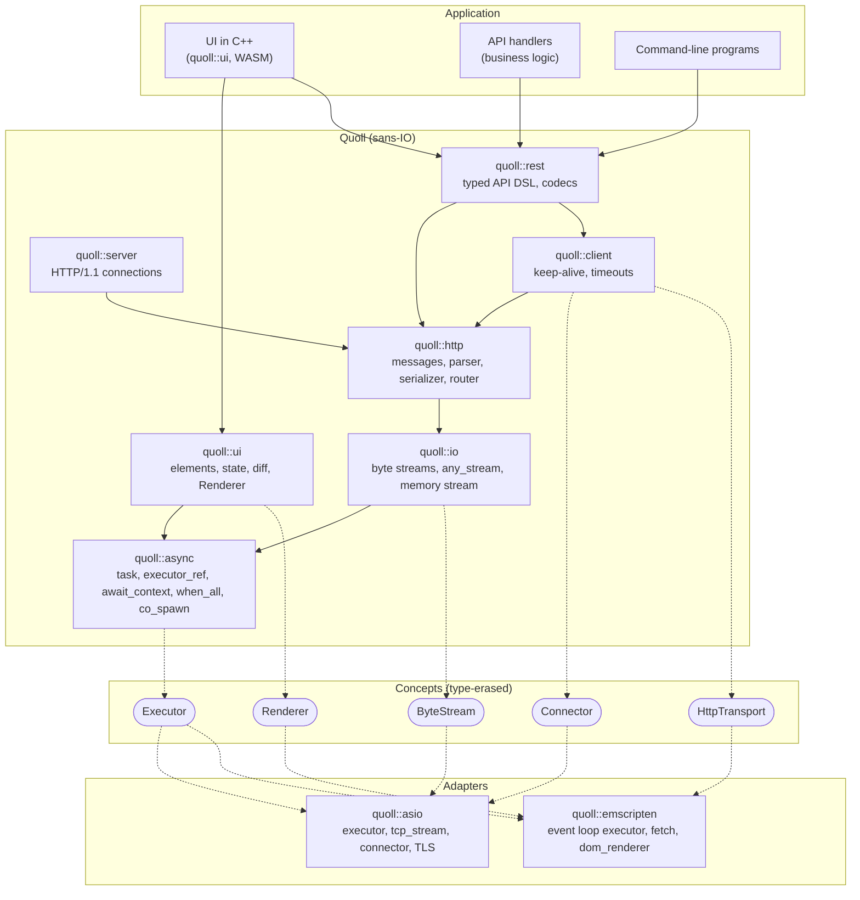

# Quoll — plan

Last update: 2026-11-14. What is to do, and its priority, is in the GitHub project
[Quoll](https://github.com/users/4thlabs/projects/2), one issue per item. This plan keeps the target, the positioning, the decisions and the architecture, and the [roadmap](#roadmap)
says what each step brings.

## Target

A C++ web framework aimed at **performance and ease of use**, in three parts that work apart or together:

- **Client and server:** HTTP over any runtime, secure, streaming and fast, with SSE and WebSocket.
- **REST:** an API described once with the DSL, then served or called, from a command-line program as from anywhere
  else, with a runtime (asio, or another).
- **UI:** a C++ DSL compiled to WASM (the Emscripten runtime), which gives one application for web, desktop and mobile.
  Styled with Tailwind, with base components provided and hot reload. Quoll drives the tools, Vite among them, and not
  the reverse.

Build time and hot reload are kept short and measured all along.

## Positioning

The aim is to show that C++ can offer a solid web framework. Who to show it to first:

- **C++ programs that lack a web interface,** in robotics, simulation, finance, video or computing. They often end up with a
  service in Python and a page in React, with their types written twice. What Quoll offers them: *give your C++ program a web
  interface, in the same language and the same binary.* Their existing code, used with no FFI, is also what a Rust
  framework cannot offer them. That holds for programs Quoll can build with: see
  [step 7](#step-7-the-quoll-command-driving-vite-maintainer-merges-the-first-pull-request).
- **New web applications** next, once [authentication](#step-8-authentication-maintainer-merges) and the
  [ORM](#step-9-an-orm-maintainer-merges) exist. A developer happy with TypeScript gains little from changing, and is not who
  this aims at for now.

What shows it, rather than an argument, with no public announcement before step 7 is done:

- A short video: a field of a `struct` that the server and the page both use is renamed and neither compiles, then a Tailwind
  class changes and the page follows, keeping its state. It claims no more than that: reflection adapts to a field no code
  names, which then only fails when strict decoding meets it, at run time.
- A demo people run themselves, in one binary. To settle: which. Proposed: an explorer over DuckDB, which opens a CSV and shows
  results as they arrive. DuckDB has an interface of its own, so that this stays a demo and not a product.
- The framework's site, written with Quoll, served by Quoll behind a reverse proxy, with its source in view.
- A page saying what is guaranteed (the nightly fuzzing, ASan, UBSan and TSan) and what is not (see
  [step 2](#step-2-client-and-server-security-and-completeness-done)), as "C++ exposed to the Internet" is the first objection: the answer
  is a reverse proxy in front, and a server that still defends itself.

The figures to lead with are those of size, build time and memory (see [Done](#done)). Not the rate:
[nginx is ahead of Quoll](BENCHMARKS.md#beside-other-servers), and performance comes last on the roadmap.

## Roadmap

What is to do, and its priority, is in the project [Quoll](https://github.com/users/4thlabs/projects/2): each step
from 6 on, and each open item of step 6, links its issue.

One pull request per topic, under the rule in [`AGENTS.md`](../AGENTS.md). A new public API is shown to the maintainer
before much is built on it. Points marked "To settle" and the [open questions](#open-questions) are the maintainer's to
decide. Steps marked *(maintainer merges)* are big architecture changes.

**Current step: 6.** Step 0 only waits for the maintainer, and step 5's WebSocket in the browser and in the REST DSL for
a page that needs them ([#213](https://github.com/4thlabs/quoll/issues/213)).

### Done

`async`, `io`, `http`, `client`, `server` and `rest`, with timeouts by default and TLS (a client GET and a REST client
over TCP, over `fetch`, and through OpenSSL). A first `quoll::ui` with its DOM renderer, Tailwind through Vite, and two
levels of hot reload, in the sample `samples/notes/web`. In CI: `clang-tidy`, the standard library's checks, Apple Clang on macOS, Codex's review and a protected `main`.

SSE and WebSocket (step 5, but for WebSocket in the browser and in the REST DSL): typed events in the REST DSL, natively
and through `fetch`, WebSocket natively, their parsers fuzzed, and every night against third-party clients and servers and
Autobahn's suite.

REST from a command-line program (step 4): a client's scopes and interceptors, form and bytes codecs, `open_enum` for the
values an enum does not know, and `samples/github`, calling GitHub natively and in Node through `fetch`.

Client and server (step 2): the reviews of each module, a runtime on several threads with a strand per connection, a
coroutine frame destroyed only once it will not resume again, which a program reaches no way of breaking through
`co_await` and `co_spawn`, and debug builds assert, and every night the fuzz targets, eleven today,
a mixed load under TSan and under ASan with UBSan, and `clang-tidy` with its analyzer, with no crash open.

Streaming (step 3): a body in pieces on the server, the client and browser `fetch`, a minimum rate, static files. 32 GiB each way
through a process that never holds more than 10.3 MiB, checked every night at 1 GiB.

Compiled libraries (step 1, 2026-11-05): a program using `quoll::runtime` compiles neither llhttp nor asio. A page rebuilt in 0.81 s and a
native server in 3.9 s, for 52 KB of gzipped WASM with the REST client, against about 45 KB for React and ReactDOM alone. A literal shows in about 31 ms,
keeping the state.

### Step 0: finish the setup

What is left is the maintainer's:

- Require the job `macos` on `main`.
- Delete the secret `CLAUDE_CODE_OAUTH_TOKEN`.

*Done when:* both are done.

### Step 1: compiled libraries *(done)*

`src/*.cpp` and one mode, like Capy and Corosio, rather than the two modes of `.ipp` files. What stays in headers is what the
coding rules list. An installed Quoll runs a program with no asio available, checked by hand: nothing in CI does it yet, and it
still links OpenSSL.

Figures, from the first PR of this step to the last, without ccache:

| | Before | After |
|---|---|---|
| Rebuild of a page | 1.15 s | 0.81 s |
| Reload of a page after a rebuild | about 1.2 s | not measured again |
| Gzipped WASM | 51.47 KB | 51.86 KB |
| Rebuild of a native server | 13.7 s | 3.9 s |
| Full build of a native server | 13.7 s | 9.5 s |
| Binary of a native server | 1013 KB | 1206 KB |

Two things follow from compiling once. A program is built in the same mode as its Quoll: an `assert` in a source follows the
library's build type, and inline code holding one, compiled on both sides, is an ODR violation when the modes differ, which
nothing detects. A program using `tcp_stream` or `runtime::context()` compiles asio too, in the same version as the library,
which nothing checks either.

### Step 2: client and server, security and completeness *(done)*

Exposure to the Internet goes through a reverse proxy (decided on 2026-11-07, see [Decided](#decided)), what was built for a
direct exposure stays, and RFC corners that touch neither security nor stability are not guaranteed. `Expect: 100-continue` is
done, with a body too large refused at its head, and so is ending a connection: it stops sending first
(`io::HalfClosableStream`), which a TLS peer reads as its closing message, and after the last response what still comes is
read and dropped (`lingering_timeout`, `lingering_time`). `100 Continue` is sent without asking the router, so that a request to a route that does not exist
still sends its body: to look at with streaming. A client closes its TLS connections without that message.

- Limits and shutdown: graceful shutdown, a connection limit and a wait when out of file descriptors are done
  (`serve_options`), and limits on headers and bodies were there (`http::parse_limits`).
- Reliability, in the manner of Rust. C++ has no borrow checker, but types and tools give a good part of what it
  guarantees:
  - Done: `QUOLL_LIFETIMEBOUND` (`[[clang::lifetimebound]]`), with `-Werror=dangling` on Clang. What a handler or a middleware
    takes by reference lives in a frame of the router until its task ends, so that a reference is no longer a trap. Dropped,
    as measured: `[[clang::coro_return_type, clang::coro_lifetimebound]]` on `async::task`, as it refuses any function
    returning a task that is no coroutine, which `std::function` and `std::invoke` are, and they cannot be annotated.
  - Done: `async::detail::synchronized<T>`, a mutex holding its data, in `connection_pool`, `task_group` and the asio
    `runtime`. It takes a function rather than handing out a guard, and refuses one returning a reference or something to
    await. Clang's `-Wthread-safety` was compared and dropped, as measured: it needs a mutex of our own, annotated, as
    libstdc++'s `std::mutex` is not, it warns on correct code without it, and only Clang checks it.
  - Dropped, as measured: `cppcoreguidelines-avoid-capturing-lambda-coroutines` in `clang-tidy`. Of its 90 findings, 89 are in
    tests, kept alive by their own frames, and the other, `ui::detail::to_handler`, is documented and kept alive by its caller.
- Fuzzing in CI, under ASan and UBSan, is done (`tests/fuzz`, five minutes per target every night, keeping its corpus): the
  HTTP parsers, `serve_connection`, the router, the REST decoding, the client's exchange and the decoding of REST responses.
  Two more, `unfolding_server` and `unfolding_client`, run a connection over a stream the input scripts: each read and
  write comes in a piece of any size, now or later, or fails, and any operation may hang until a timeout or a stop ends
  it. The exchange must end.
  They reach the timeouts and the cancellation, which the others' stream, never suspending, does not.
- What a handler answers is replaced when its peer would read it as something else, through a connection as through
  `local_transport`: a 2xx to CONNECT, a tunnel, which is not offered, answers 501; a 1xx, and a `Content-Length` with no body, but
  to HEAD or as a 304, answer 500.
- The first nightly fuzz run, on 2026-11-06, found nothing: five minutes on each of the seven targets of then, from 225,000 to 12 million runs.
- Features: middlewares (`router::use`) and routes whose handler takes the path's parameters, checked at compile time
  (`router::get`...), a path prefix in the base URL, a connection limit per transport and client redirects, are done. A client's `response_timeout` applies per attempt, so a deadline over the whole `send` if that proves
  confusing.

What stays out of reach: the lifetimes of coroutines remain mostly documented rules ("what a coroutine takes by reference outlives it", when
the task outlives the line it was made on), a use after move across functions or through a member goes unseen, and a
lambda can still capture by reference what dies before it.

*Done when:* the fuzz targets run in CI with no open crash, the limits, the shutdown and the features are tested, and the
reliability points are in place or dropped with a reason.

Done on 2026-11-08, with what the reviews of each module found fixed (#97 to #108, but #102, which records the reverse
proxy), and since: `quoll::runtime` on several
threads with a strand per connection (#110); a coroutine frame destroyed only once it will not resume again, asserted by
the task's promise, and a task a program cannot start itself nor await by name (#112, #116); the thread pool gone (#115);
every night, a mixed load under TSan and under ASan with UBSan (#113), and the fuzz of how a connection unfolds (#114), with
`clang-tidy` and its analyzer, green again with #117. Run on main by hand on 2026-11-08, with no crash: the fuzz after
#116, the load and `clang-tidy` after #117.

### Step 3: streaming *(done)*

- Done: a benchmark harness (requests per second, latency, allocations per request) and its baseline, in
  [`BENCHMARKS.md`](BENCHMARKS.md), as streaming touches the hot paths.
- Streamed request and response bodies, on the server, the client and browser `fetch`. A handler takes an `http::body_reader`
  to read its request in pieces, a message's `body_writer` writes in pieces through an `http::body_stream`, and a client's
  `client.stream(request)` reads a response in pieces. Done: `http::parser` hands a body over in pieces, with `http::read_body`, and `http::body_reader`: a handler taking one asks for `100 Continue` by reading, and goes by the read timeout and its minimum rate, below. And `response.body_writer`: chunked by default, by the write timeout and its minimum rate. And `client.stream(request)`, with `http::streamed_response`: a read timeout per piece, and a connection back at the end of the body. A client sends a request in pieces through its `body_writer`, on a connection of its own, as a writer runs once, with the response read meanwhile so that a server refusing a body is heard; `fetch` and `local_transport` gather what it writes first. And `client.stream(request)` through `fetch`, with the same `http::streamed_response`: one piece per JavaScript read of `response.body`, so that nothing holds the body whole.
- Done: `http::static_files`, a middleware that answers what the router answers 404 to, in pieces, with a cache and ranges. It
  reads through `async::offload`, a service of an executor that runs blocking work on threads of its own, which only an adapter
  has: the core still needs none. It costs about 4% of the rate of a file already in the page cache, and a slow disk no longer
  holds up the loop. `io_uring` may take over behind the same service if a measure asks for it.
- Done: a minimum rate on the server, `min_read_rate` and `min_write_rate`, 16 KiB/s by default: a body's bytes, or what leaves, add to
  what `read_timeout` and `write_timeout` have left, up to themselves, so that a slow link has the time it needs, and a peer
  sending a little now and then runs out of it. Static files go by the same.
- Done, by step 2: a half-close, `io::HalfClosableStream` and its `shutdown_send()`.

*Done when:* a transfer far larger than memory runs in bounded memory, on both sides, with the figure measured. Measured: 32 GiB
each way, a request, a response and a file, with a process that never held more than 10.3 MiB, in
[`BENCHMARKS.md`](BENCHMARKS.md#larger-than-memory).

### Step 4: REST from a command-line program *(done)*

The DSL and a runtime, with no UI.

- On the client: `scope<Api>(prefix arguments...)`, and interceptors around `send` (retry, token refresh on 401).
  Scopes went on 2026-11-14 (#227), with nested prefixed apis: a route's parameters are passed at each call.
- Third-party APIs, as [the REST DSL](#rest-dsl-contract-server-client) describes: renamed fields, unknown fields, error
  bodies of any shape, codecs. A contract alone, with no Quoll server in the program.
- A sample and a guide for a command-line program: `samples/github`, GitHub's API as the real one, as decided on
  2026-11-07. A client of Docker over a Unix socket comes later, in no step yet.
- After this, and optional: an OpenAPI document generated from the DSL, to document an API or for third-party clients,
  and a generator of contracts from existing documents.

*Done when:* a real third-party API is called from a command-line program, natively and through `fetch`, with
`call`, `try_call` and credentials.

Done on 2026-11-08: a client's scopes and interceptors, with `rest::retry` (#119), the form and bytes codecs (#120),
`samples/github` calling GitHub natively and in Node through `fetch`, tested against fakes, with
[`docs/command-line.md`](command-line.md) (#121), and `rest::open_enum<E>` for the values an enum does not know. The OpenAPI
document stays optional, for later.

### Step 5: SSE, then WebSocket

- SSE first, as it rests on step 3: a DSL route kind returning typed events, a client, the browser. The browser reads a
  streamed `fetch` rather than `EventSource`, which takes no headers: an API with credentials could not use it.
- WebSocket: the upgrade, frames, a client, the browser adapter, its shape in the DSL.

SSE is done on 2026-11-09: the parser and its formatting, fuzzed (#123), `http::event_writer` and `http::event_reader`
over the transports (#124), and `rest::events<T>`, its `event_sink` and the client's `subscribe`, natively and through
`fetch`, run in Node by CI as the browser's stand-in, as for step 3.

WebSocket is done natively on 2026-11-10: its frames, fuzzed, and its handshake (#126), `http::websocket` and
`accept_websocket` through `response::upgrade` (#127), `connect_websocket` (#128), which keeps itself alive as Beast does
(#129). The interop tests run every night (#150): Quoll's server against curl, Python and Node as clients, its client against
Node's and Python's servers, Quoll's client and server through nginx as a proxy, and Autobahn's suite both ways, without its
permessage-deflate cases, as Quoll offers no extension. Left: the browser's WebSocket and a WebSocket shape in the REST DSL,
which come when a page of step 6 needs them (see [Decided](#decided), 2026-11-10): [#213](https://github.com/4thlabs/quoll/issues/213).

*Done when:* each runs end to end, natively and in the browser, with its frame parsing fuzzed.

### Step 6: the UI DSL, complete

Its issue: [#163](https://github.com/4thlabs/quoll/issues/163). Done:

- Nested stateful components, placed by calling them, their hooks kept by component and key, their effects, actions
  and handlers stopped as they go; `ui::callback<Signature>` in props, run in the task of the component that wrote it
  (2026-11-10); a view not run again when its props compare equal and none of its states changed (2026-11-11).
- How a page writes its names: `using namespace quoll::ui;` once in the application's namespace (2026-11-12).
- The JavaScript libraries a page needs, a requirement said on 2026-11-07: `widget<Props>(module, tag)`, its node left
  to a module's `mount`, `update` and `unmount`, its props as JSON, what it emits read by `on(name, function)`, and
  `WidgetRenderer`, its module loaded on demand in the browser (2026-11-11). Plain DOM libraries and web components
  come this way; those tied to React cannot.
- The trial screen, `samples/dashboard` (2026-11-11): a list to filter, a detail to edit, a chart.js chart fed by the
  REST API. Its README lists what it lacked; `ui::effect`, `ui::action` and `ui::form_state` took the place of the
  bookkeeping its reviews kept finding bugs in (2026-11-12). It needed no handle on the widget, and no WebSocket.
- Contexts (2026-11-12): `provide<T>()` in the app's options, `shared<T>` in a component, `run()`, and `provided<T>`,
  a context a component provides to those of its view. Stores are planned to replace them ([#206](https://github.com/4thlabs/quoll/issues/206)).
- Routing (2026-11-12): `routes(...)` of `route<Path, Page, fields...>`, layouts with `outlet()`, `redirect`,
  `not_found`, `routing<routes>(history)`, `link_to`, the browser's history; the dashboard is pages.
- A component in its header, as a struct of sections (form S) or a function of its props (form D), and `resource<T>`
  (2026-11-13, [the UI spec](specs/ui-dsl.md), #189 to #193).

Left, each an issue of the project:

- Calling the REST API cleanly from components: [#197](https://github.com/4thlabs/quoll/issues/197).
- `use_resource` for form D: [#198](https://github.com/4thlabs/quoll/issues/198).
- Effects, actions, forms and loads compiled once in the library, with a rebuild budget in CI: [#199](https://github.com/4thlabs/quoll/issues/199).
- The samples in forms S and D, in their headers: [#200](https://github.com/4thlabs/quoll/issues/200).
- Glaze out of the UI, under [#182](https://github.com/4thlabs/quoll/issues/182): contexts found without it, [#204](https://github.com/4thlabs/quoll/issues/204), and the widgets' JSON through
  `json_codec`, [#205](https://github.com/4thlabs/quoll/issues/205).
- Stores, to replace contexts, with what a context keeps per item, as a save of a product once at a time across its
  details: [#206](https://github.com/4thlabs/quoll/issues/206).
- What the trace of a component's life cycle found surprising: [#207](https://github.com/4thlabs/quoll/issues/207).
- Base components, styled with Tailwind: [#208](https://github.com/4thlabs/quoll/issues/208).
- Two siblings with the same key, an error rather than an `assert`, and a state changed on an app never started:
  [#209](https://github.com/4thlabs/quoll/issues/209).
- A handle on a widget, for calls that are not props, as writing to a terminal: [#210](https://github.com/4thlabs/quoll/issues/210).
- Hydration, then pages written by a server, and a `value` on a `select` that selects nothing: [#211](https://github.com/4thlabs/quoll/issues/211).
- Restoring the states after a rebuild, the third level of hot reload: [#212](https://github.com/4thlabs/quoll/issues/212).
- WebSocket in the browser and in the REST DSL, left from step 5: [#213](https://github.com/4thlabs/quoll/issues/213).
- In the notes sample, a note added during the first load can be hidden until a reload: [#163](https://github.com/4thlabs/quoll/issues/163).

*Done when:* that screen runs with the base components and a JavaScript library loaded on demand, called from C++ and
calling back, mounted and unmounted, with what it lacks listed.

### Step 7: the `quoll` command, driving Vite *(maintainer merges the first pull request)*

[#214](https://github.com/4thlabs/quoll/issues/214).

**To settle at its start:** a native binary, or an npm package (`npx quoll`), as Node is needed for Vite anyway and it
avoids a binary per platform. The commands are shown to the maintainer first.

```bash
quoll new my_app
cd my_app
quoll dev      # build, watch, Vite, hot reload
quoll build    # dist/, with the pages that can be written ahead of time as HTML, and a PWA
```

- The plugin leaves the sample, with its scanner tested in CI. Vite and Tailwind's setup become internal, and an
  application writes neither.
- Its limits as a prototype: a failed first build stops the server, a Vite restart during a build can run two builds in
  one directory, an error with no page open can show once on the next page, and a multi-line macro holding a tag is not
  told apart.
- Build time and hot reload, measured, with a target set at the start of this step from the figures of step 1.
- A PWA from `quoll build`: a manifest and a service worker, so that an application installs on desktop and mobile and opens
  offline. Nothing of it exists yet but the type `http::static_files` gives a `webmanifest`. Installed PWAs are restricted on
  iOS (storage eviction, background work): to check.
  - How it updates: an installed page may run older WASM than its server, and every codec's decoding is strict
    (`error_on_missing_keys`), so that a field added to a shared `struct` answers its POST with 400 until the worker updates.
    What such a page does is to settle with the maintainer.
- A web interface for an existing program, as [Positioning](#positioning) asks:
  - Its files embedded in the binary: `http::static_files` serves a directory.
  - Quoll beside a program's own main loop, on a thread of its own, needs an API first, shown to the maintainer. `run()` returns
    once no executor is left, so at once if none was taken yet; an executor kept to reach the loop later keeps it running for
    ever, so that joining that thread hangs; nothing stops a runtime but its tasks ending; and `get_stop_token()` takes SIGINT
    and SIGTERM, which such a program handles itself. How the program's data reaches the loop's tasks goes with it.
  - What an existing program can build with, tried on a real one and not only on a new sample: C++23 with GCC ≥ 13, Clang ≥ 19 or
    Apple Clang ≥ 21 leaves out MSVC and older distributions (see [open questions](#open-questions)); another version of
    standalone asio in the same binary is an ODR clash, as asio has no versioned namespace; and the program's build mode must
    be its Quoll's. What cannot be fixed is said in the guide.
- Ready for LLMs, as an agent is now how many people will first write Quoll:
  - `quoll new` writes an `AGENTS.md` and a skill into the project, for the version of Quoll it uses, with the commands, the
    rules a program must follow, and where the guides are.
  - The repository publishes an `llms.txt` over its guides, and each guide stays readable alone.
  - What the guides show compiles in CI, as an agent copies it as it stands: their C++ blocks are checked by hand for now.
  - The errors of the `quoll` command, and the `static_assert` messages of the DSLs, say what to change, as that is what an
    agent acts on. They stay tested by `compile_fail`.

*Done when:* a new project reaches a running page with hot reload through these commands, and `samples/notes/web` uses
them; that project installs as a PWA, opens offline and takes an update; an agent given only what `quoll new` wrote adds a screen
and an endpoint to it; and an existing program with its own main loop serves its interface from one binary, stops cleanly with
it, and has its test and its guide.

### Step 8: authentication *(maintainer merges)*

[#215](https://github.com/4thlabs/quoll/issues/215).

Before the ORM, as the first programs [Positioning](#positioning) aims at often have no SQL database, and need to sign in as
soon as they listen beyond their machine. It first settles what a reverse proxy forwards, under
[Open questions](#open-questions), for its redirects and cookies. Sessions go through a store of their own (memory, a file), which the ORM implements
once it exists. A new module, as it needs cryptography that `quoll::rest` and `quoll::server` do not have and must not bring to
WASM builds.

- Signing in through an OIDC provider and sessions, a shared secret in a program's configuration for a machine on a
  closed network, and a local account with a password, decided on 2026-11-07 against the "no store of passwords" proposed
  before: its hashing is part of the cryptography to settle below.
- Cryptography: nothing in Quoll hashes, signs or draws secure random numbers for security. OIDC needs ID tokens checked
  against the provider's keys, a nonce and PKCE, and session ids from a secure source. **To settle at its start:** OpenSSL,
  as TLS uses, or something else, and what a build with `QUOLL_TLS` off does. None of it written by hand. WebSocket's
  handshake is no cryptography, decided on 2026-11-09: its `Sec-WebSocket-Accept` is an SHA-1 RFC 6455 uses as an interop
  check, written by hand in `quoll::http`, and a client's masks, which keep proxies from reading frames as requests, come
  from `std::random_device`; so that WebSocket runs with or without TLS.
- What the REST DSL lacks: validators answer `bool`, and a service takes only the endpoint's arguments, so that a handler of
  `GET /me` cannot learn who calls; and a scheme cannot be a cookie, as `rest::security` accepts only `api_key<>`,
  `api_key_query<>` and `bearer_auth`. A validator's result reaching the service, and a cookie scheme, shown to the maintainer.
- A page: an OIDC redirect is a navigation, which `quoll::ui` and the Emscripten adapter do not offer, and which loses the WASM
  state. In a browser, `http::client` sets no `credentials`, so that a page calling another origin neither sends nor keeps a cookie.
- A native client: `http::client` has no cookie jar, and drops `Set-Cookie` across redirects. To settle whether it needs one.
- Cookies and what they ask: expiry, revocation, CSRF.
- What it parses from outside, tokens among them, is fuzzed.

*Done when:* a sample signs in through a real provider, from a page too, and with a local account and its password, its sessions survive a restart through a file, and
expiry and revocation are tested, with its guide.

### Step 9: an ORM *(maintainer merges)*

[#216](https://github.com/4thlabs/quoll/issues/216).

A new module. **To settle at its start:** the shape of a query, shown to the maintainer first, the first database, and
migrations.

- A table is described by a plain aggregate, through Quoll's own reflection of aggregates, which the REST DSL takes up
  (#182), so that one `struct` may go from the database to the browser, and a field the program names breaks the compilation all along. The compiler does not see the
  database: a `struct` changed with no migration has to be caught when the program starts, not on its first query.
- A column kept from the browser, a session's hash or a provider's token: a route whose result is `user` writes every reflected
  field, and a field hidden from one description of the type would be hidden from the other too. Excluding a field per
  output, or a type of its own for what is sent: to settle, as the easy path must not leak secrets.
- Native only, as `quoll::asio` is: the core still compiles to WASM with none of it.
- A query never blocks the loop, and can be given up. A driver over `quoll::io` streams does both. A C client cannot go through
  `async::offload` as it is: two threads shared with `http::static_files` starve under slow queries, and a call started cannot be
  stopped, so that a timeout waits for it, and so does a shutdown. It needs threads per database and a way to cancel.
- Against a real database in CI.
- Sessions of step 8 stored through it.

*Done when:* a sample stores its data through it, from a contract shared with its page, with its guide.

### Step 10: desktop and mobile *(maintainer merges)*

[#217](https://github.com/4thlabs/quoll/issues/217).

Secondary to the maintainer, as the PWA of step 7 already installs there.

- A webview shell on desktop, then on mobile, loading the same WASM.
- Native capabilities (files, sockets) through a small gateway, designed at this step. The webview library is to be
  chosen.
- Webview engines differ: WebKit on iOS, macOS and Linux, Chromium on Windows and Android. To check on each.

*Done when:* the sample runs on each target, with the differences between engines listed.

### Step 11: performance

[#218](https://github.com/4thlabs/quoll/issues/218).

Last, as what comes before it is needed first. It starts from a new baseline, as those steps change what is measured, and
changes only what the harness shows. Candidates:

- Each bounded phase takes a coroutine frame, recycled by each thread since `async::detail::recycled_frame`, and an asio timer,
  about three times per request on the server. A timer per connection avoids it. On several threads, each wait and each
  connect also makes a strand, and a socket's completion goes through its own strand, then its connection's: the timer and
  the socket on the connection's strand would avoid both.
- A client copies the request body into the serialized message: write the head and the body as two buffers.
- A TLS client builds its context per connection, and resumes no session.
- A client builds a parser per request, which now allocates: one per connection avoids it.
- A body in pieces still takes about 4 allocations per piece behind `http::body_reader` and `http::body_stream`, from what its
  timeouts do, and those wrappers return a task rather than an awaitable in storage of their own, as the type-erasure rules
  ask. With frames recycled that task allocates nothing in steady state, and changing it changes no handler.
- The size of a native binary, 19 % larger since step 1, as static libraries link whole objects: `--gc-sections`, link-time
  optimization.
- Idle connections are found closed only as a request takes one, with a poll (decided below), and one idle for longer than
  `max_idle_time` is not used again: closing them as that time passes, with no request to find them.

*Done when:* figures are published against that baseline, and each change is justified by a measure.

## Decided

- **A callback given in props runs in the task of the component that wrote it, implicitly** (2026-11-10), the design
  doc's choice 3a, against a task of the caller's or an explicit `spawn` of the parent's: the child that calls it
  stops waiting as it goes, and the parent's work goes on. The user writes neither `spawn` nor an annotation: the
  component is the one whose view makes the callback, so that one made elsewhere, in a handler or an effect, runs in
  its caller's task. A callback compares equal to any other that calls something, whatever its function captures, so
  that props holding one compare by the rest, for the skipped views of step 6. A view not run again keeps the
  callbacks of its last one, so that one capturing what changes from a view to the next calls with what it captured
  then: the guide says to capture only what does not change, and to pass the rest as props (2026-11-11, against
  callbacks refreshed in a view not run again, or never equal).
- **What a component runs as a state changes, and on a click, are Quoll's to keep, as React's useEffect**
  (2026-11-11), as the dashboard's reviews kept finding stale answers and saves out of order, handled by hand.
  `ui::effect` is `useEffect` with states of the component as its dependencies, one, several through `std::tie`, or
  none, compared with `==` after each view; the run before is stopped as its cleanup, and as a stop resumes nothing
  (#151), its answer writes nothing; an optional state runs it only while it holds a value. `ui::action` runs a function
  once at a time by default, a call while one is under way refused, with the others as options (a call stopping the one
  before). An effect writes into a state of the component, its target, an action into its own (see below), and the
  view reads states only, as a React effect
  calls its setters: the target's elements receive by their type, a `bool` whether a run is under way, a
  `std::exception_ptr` why the last failed, and the others the values, in order, a function giving a `std::tuple` for
  several loads; an ambiguous target does not compile. A failure reaches `on_error` too (see below).
  An action's caller is given what it gave, a `std::expected<T, std::exception_ptr>` (`run_refused` and `run_replaced`
  for a call with none of its own). An effect runs one way, after a view, as React's: `reload()` asks for that view
  rather than run it. Decided with the maintainer: a home-made `resource<Key, T>` with a key and a loader came first and
  was found less clear than React's model, and the maintainer asked that a good principle React already has be taken,
  not invented again; then an effect and an action holding their status and result, two ways for a view to read data,
  and named queries tied to the REST DSL, which a component need not use, were set aside, as was `keyed_action`: a
  component per item has its own action, which runs a callback of the component owning what the save changes, so
  that the save goes on as the item goes.
- **Less to write for a load and a save** (2026-11-12), as the maintainer found the targets and the actions of the
  dashboard heavy to write. `ui::async_state<T>` is a state of `value`, `loading` and `error`, read by name rather than
  as a tuple, `async_state<>` with no value; tuples stay as targets for several values. An effect's target is loading
  from the start, as React's `useState(true)`, when its first run will start (not on an optional holding none), said
  by a walk of the effects before a component's first view. `ui::action<&function>` deduces its signature from a free function, a
  member function of a context given its `shared<C>`, whose work goes on as the component goes, or of the component
  given `this`; `with(args...)` gives a handler for `on_click`, and what follows a success is given as the action is
  made, as React Query's `onSuccess`, rather than a coroutine awaiting `run()` in each component. Kept: `state`, which
  the maintainer wanted kept, rather than new names such as `loaded<T>`; `run()` for a handler going on with the
  result.
- **An action holds where its runs are** (2026-11-12), as React Query's `useMutation`: `save->loading`, `save->error`
  and `save->value` are read as an `async_state`'s, which the action holds, and a change of them shows its component
  again; it takes no target. The maintainer found a state declared beside each action hard to name and to read
  (`saving`, which said one of its three fields), the state of a save being the action's own. It changes #167's "no
  status on the members" only in form: the action is read as a state, so the view still reads states only. An effect
  keeps its target, which is the data it loads.
- **Components are functions, their state their `use_` hooks** (2026-11-12), as React's: superseded on 2026-11-13 by
  [the UI spec](specs/ui-dsl.md), below, which keeps these hooks for form D. Still in force from it: a hook is
  found by the place of its call and how many times that place was called before in the view, and what a view writes
  takes effect once that view shows, as React's committed render; `use_context` and `provide_context` take Leptos's names.
- **A component is an object of its props, placed by calling it** (2026-11-13), as React's JSX places one, the
  maintainer refusing `component<product_detail>(...)` in a view: `product_detail({.item = item})`, which routes, links
  and the app's root name, `mount(app_shell, "#app", options)`; an effect on nothing runs once, as `mounted()` went.
  Its one rule, `constexpr component<props>` always written, and a header and a source for each component, never
  `inline`, were superseded the same day by [the UI spec](specs/ui-dsl.md), below. Still in force: a page's folder
  keeps its tools' files at its root and its code in `src/` by role, and a rebuild of one component takes a second at
  most, the maintainer's budget, which #199 measures and checks in CI.
- **Form S, a component written as a struct** (2026-11-13, [the UI spec](specs/ui-dsl.md)): its first part done,
  `struct note_counter : component<note_counter>` with `struct props` read through `given->`, states, effects, forms
  and `shared<T>` as members that join it as the app makes it (`member_join`, no reflection), handlers as member
  functions, `element view()` that may still call `use_context`, placed by `inline constexpr tag<note_counter>
  note_counter;`, which routes, links, `go` and the root take. An effect follows a prop by its member pointer,
  `effect load{&props::id, products_client::sales, sales};`, or a function of the props for a nested field, a base's
  or a value computed, `[](props const &given) { return given.item.id; }`, read from the props of each view (a
  reference, `given->id`, would dangle as the props are replaced). `resource<T>`, an `async_state` and its effect,
  read with `match(loading, failed, loaded)`, the first given the value before if it asks, and an optional `idle`
  first. Left: `use_resource` for form D (#198), and Glaze out of everything but JSON (#182: #201 to
  #205).
- **Form D, a component's props its view's parameters** (2026-11-13, [the UI spec](specs/ui-dsl.md)): done,
  `inline constexpr component note_row = [](notes::note const &item, bool const &selected) {...}` is a
  `component<parameters<notes::note, bool>>`, placed `note_row(item, true)`; one parameter is the props, as
  `component<chart_props>` with its fields named as it is placed; none a `component<>`. `component<props>` stays, as an
  `extern` declaration needs it. Parameters are kept with the component, so a view among them does not compile; one
  without `==` makes it viewed again at each view of its parent; a routed page takes one struct.
- **A component is a struct of sections or a function of its props, in its header only** (2026-11-13,
  [the UI spec](specs/ui-dsl.md)): the maintainer found the declaration unreadable, the concepts mixed in one
  body ("ce n'est pas lisible et on mélange les concepts"), kept the view's decorators, and chose both forms of a
  study of other frameworks and of a Rust rewrite of the samples, without reflection. Form S, `struct product_view :
  component<product_view>`, its `struct props` first, then its contexts, states, loads, effects and actions as members
  that join it as the app makes it, its handlers as member functions and `element view()`; placed by name through a
  variable of the struct's name, `inline constexpr tag<product_view> product_view;`, which keeps today's calls,
  `product_view({...})`, `link_to(product_page, {...}, ...)`, `mount(app_shell, ...)`. Form D, a lambda whose
  parameters are its props, `inline constexpr component product_view = [](products::product const &item) {...}`, with
  today's hooks. A load is one value, `resource<T>` or `use_resource`, read with `match(loading, failed, loaded)`;
  routes name the fields their parameters fill by member pointers,
  `route<"{id}", product_page, &product_page::props::id>()`. The two forms came first (#189 to #193). Header-only
  makes a page one unit: it fits the second's budget, up to about 30 components, once Glaze leaves the UI's headers
  (#204, #205) and effects, actions, forms and loads are erased into the library (#199). Modules later,
  with GCC 15. Against the 2026-11-12 count (a struct form generating three times the code of a function), form S's
  effects follow a field or a function of their props, read from the props of each view, and its tables are to be
  erased: #199 measures it, form D staying if it costs as much. The samples move to the two forms with #200.
- **A debounce is an option of the effect** (2026-11-12), as the maintainer chose over a `debounced<T>` value to
  declare beside the state, as React's `useDebounce`, and over a pause Quoll would add to any change made by typing:
  `effect search{query, f, found, {.debounce = 300ms}}`. A run that follows a change waits that long before it calls
  the function, its target loading, and the next change stops it there, as any run is stopped; the first run that
  starts and one `reload()` asks for do not wait. It replaces a `sleep_for` at the top of the function, which mixed the pause with
  the call.
- **A form edits a value its props give** (2026-11-12), as React Hook Form's `defaultValues` with `keepDirtyValues`:
  `use_form(given.item)` takes the value its view gives at each view, `bind(form, &item::price)` keeps an
  input and a field the same, reading the text by the field's type, `valid()` says whether every field typed in reads,
  and `action::with(form)` runs an action with the value as it is at the click, refused while it is not valid. When the
  props give another value, as once a save comes back, a field typed in that holds it is typed in no more: no reset to
  write, nor a callback after the save. The maintainer found a draft of optional strings, compared by hand with what
  was saved, hard to read, and named it `form_state`, as `form` is the HTML tag. Another value to edit from the start
  is another component, with a key, as React resets a state.
- **Every failure of a run reaches the app's `on_error`** (2026-11-12), shown or not, as React Query's global
  `onError`: an effect's, `with()`'s, a handler's alike; the target or the action says what the view shows. The
  maintainer found it a pity that `on_error` heard of a failure or not by what the target could hold. `run()`'s caller
  alone is given its failure, in the `std::expected`. A call refused or replaced is no failure.
- **Routing: routes checked at compile time, their parameters a page's props** (2026-11-12), as the maintainer asked
  for several pages. After React Router, TanStack Router and Dioxus: a route's path is a template, as the REST DSL's,
  whose parameters are fields of its page's props, which give their types, as Dioxus's routes are an enum of typed
  values and TanStack's links are typed; the other fields come from the query. A link to a page takes its props, and
  one to an address a string. Layouts show the page under them in an `outlet()`, as React Router's. The router is a
  context, `shared<router>`, its location a state; its history the browser's or one in memory. An effect may depend on
  a field of its component's props, as `useEffect(…, [props.id])`, so that a page loads what its parameter names;
  and a component provides a context to those of its view with `provided<T>`, as React's `Provider`, for what only
  a page needs. A route types no parameter itself, `{id}` rather than `{id:int64}`: the props do, and the two could
  differ. `link` became `link_to`, as POSIX's `link()` takes two strings and wins over it.
  Since 2026-11-13 ([the UI spec](specs/ui-dsl.md), no reflection): a route names the fields it fills, a member
  pointer for each `{parameter}` of its whole path in order, `route<"{id}", product_page, &product_page_props::id>()`,
  and by name `from_query<"q", &props::q>` and `from_path<"id", &props::id>`, the latter for a layout reading the
  parameter of the page under it. As template arguments rather than the UI spec's call arguments, which as values cannot
  name the functions reading and writing the field. A field not named stays as made: the query no longer fills every
  other field by its name, which took Glaze.
- **Contexts: data the components of an app share, given to the app, found by type** (2026-11-11 and 2026-11-12), as
  a page cannot do the save of each of its components and pass callbacks down. A context is an aggregate with no view,
  its states, its effects, and member functions; the app makes the contexts its options give, `provide<T>()`, as it is
  made, and holds them as long as it lives, so that they serve every page. A component finds one through a
  `shared<T>` member, by type, as the app makes it; a change of the context's states shows again the components using
  it, its effects start after each view of the app, and `shared<T>::run()` runs a member function of it as a task of
  the app, which goes on as the caller goes, as a callback's work does. Given to `mount` rather than made at a first
  use: what exists shows in `main`, as FTXUI's data sit beside its screen, which the maintainer liked, though FTXUI
  leaves lifetimes, stale answers and cancellation to the program. Nested contexts, as React's providers under a route,
  came with routing: `provided<T>`, which `shared<T>` finds first. Stores are planned to replace contexts (2026-11-13,
  #206).
- **The interop tests close the protocol layer, and step 6 comes next** (2026-11-10), as the maintainer asked, tired of
  reimplementing HTTP, server-sent events and WebSocket: once Quoll's ends hold against third-party clients and servers
  (#150), the protocol code takes the fixes of its bugs, those the interop tests and reviews find included, of what touches
  security or stability, and what a step lists (WebSocket in the browser and in the REST DSL, left from step 5 for a page
  that needs them; step 11's performance), but no new feature of its own. Swapping the stack was not worth it: the work is
  done, Beast does nothing for the browser, and Boost.Http is still what the [HTTP layer](#http-layer) set aside. What stays
  open is ticketed by module: the async core (#145), the client (#146, with closing idle connections as their time passes,
  a candidate of step 11), the server (#147), and HTTP's differential parsing and request smuggling scanners (#149). A
  feature an issue holds waits for a step to list it, or for the maintainer.
- **An idle connection is checked before it is used again, as curl does** (2026-11-10): a poll of its socket that does not
  wait (`io::PollableStream`) finds one the server closed, or that carries bytes nothing asked for, which is closed. A
  POST then takes an idle connection as Go's client does, if its stream can be checked; one found closed with none of it
  written goes again on a new one, as hyper does, and a POST written is never sent twice, even answered 408. Go and hyper
  keep a reader waiting on each idle connection instead: a task per connection, to stop before each use, which the poll
  needs not. Chosen by the maintainer, as the solution the reference libraries settled on, over a first rule, a POST taking only a connection
  used less than a second before, which reviews kept finding holes in: a server closing within the second, a response
  read slowly. One idle for longer than `client_options::max_idle_time`, 90 s as Go's `IdleConnTimeout`, is not
  used again, as no check sees a connection something on the way dropped with no word.
- **One HTTP error, in `quoll::http`** (2026-11-14, #176): `http::http_error`, raised by a handler or received by a
  client, with `http::problem` (RFC 9457) and `http::ensure_ok`; `rest::http_error` and `rest::call_error` went. The
  router answers one a handler or a middleware lets through, at each level: its status when raised, `502 Bad Gateway`
  when received from another call, whose status and detail are that server's (it answered 500 before).
- **Using the JavaScript libraries a page needs is a requirement of the UI** (2026-11-07), whatever form it takes: a node
  the reconciler leaves alone, a lifecycle with an unmount, calls both ways, bytes passed without a copy where it
  counts, npm packages through the Vite build, loaded on demand. Done so far: see step 6; a handle for calls that are
  not props is [#210](https://github.com/4thlabs/quoll/issues/210).
- **`samples/github` is step 4's real API** (2026-11-07), and a client of Docker over a Unix socket comes later, in no step
  yet.
- **A local account with a password** (2026-11-07) joins OIDC and a shared secret in step 8, against the "no store of
  passwords" proposed before.
- **The thread pool and `serve(executor, listener)` go** (decided on 2026-11-07, done on 2026-11-08). Several threads come
  from the asio runtime (`runtime_options::threads`, a strand per connection), `async::run_loop` is the runtime of one thread
  without asio, for tests and as an example, and blocking work goes through `async::offload`. With them goes the question of
  timeouts on connections served on a pool, which had no timer. What its tests checked of `quoll::async` across threads runs
  on asio's own thread pool.
- **A stop ends a task without an exception** (2026-11-10, #151), decided with the maintainer, as a `catch` around an
  operation, or a loop going on after an error code, could take a stop for a failure and spin once stopped, which nested UI
  components, kept until their tasks end, would make common. A task ends with a value, an exception, or on a stop: what ends
  on a stop resumes nothing, and the owner of the chain (a `co_spawn` root, a `when_all` branch, `stopped_as_optional`)
  destroys it from the top, as Capy's `abandon` does for a coroutine given up and `std::execution`'s `set_stopped` (P3552)
  for a stop. Code that must still run once stopped asks for it with `async::stopped_as_optional`; a `co_spawn` handler has a
  case for `async::stopped_t`; a `when_all` with a failure and a stop ends on the failure. In three pull requests, which the
  maintainer merges: the mechanism; then a task ending on `operation_canceled` while stopped, the operations of
  `quoll::async`, and the places that catch it; then the error codes of the streams.
- **A coroutine frame is destroyed only once it will not resume again** (2026-11-08): by a root as it ends, or by its awaiter
  once the task has completed, or, since #151, suspended, by the owner of its chain after a stop, which a task's promise
  asserts in debug builds, whatever destroys the frame. A program never
  starts a task itself: its `await_suspend` is private to Quoll's own awaiting. What an awaitable registers from its frame is undone as
  it resumes or is cancelled, never because the frame went, and a work item stays a coroutine to resume. Chosen over giving a
  work item a function to run, so that an awaitable could be destroyed while queued (PR #111): that case was reached only by
  a test destroying a suspended awaitable by hand.
- **Exposure to the Internet goes through a reverse proxy** (2026-11-07), replacing "Quoll may be exposed directly" of
  2026-11-05, as each review of the HTTP code kept finding more corners of the protocol. The server still defends itself: what
  a review finds is fixed, as `AGENTS.md` says, but for an RFC corner that touches neither security nor stability, as a less
  exact status, which the PR notes and lets go. Security and stability take in a crash, undefined behaviour, a data race,
  request smuggling, header injection, credentials going to another host, leaving a directory, a limit guarding memory and
  time, and a connection or a request stuck for ever, among others. What a proxy in front asks of Quoll is under
  [Open questions](#open-questions).
- Who it is for first (2026-11-06): C++ programs that lack a web interface, then new web applications, as
  [Positioning](#positioning) says.
- Authentication, then an ORM (2026-11-06), come after the `quoll` command and before desktop and mobile, which are secondary:
  a web application needs them sooner than a native shell does. Authentication depends on no ORM, as the first programs aimed
  at often have no database.
- The PWA (2026-11-06) comes from `quoll build`, in step 7, rather than with desktop and mobile: it costs little and already
  installs on both.
- Ready for LLMs (2026-11-06): a project and the guides carry what an agent needs to write a Quoll application. What it asks
  is in step 7.
- Names (2026-11-06): `http::client` and `http::server`, classes without a template parameter, rather than `client::transport<>`
  and the free functions `server::listen` and `server::serve`. A user thinks of a client and a server, not of a transport, and
  `HttpTransport` stays the concept. `quoll::client` and `quoll::server` stay libraries of their own, so that a program links only
  what it uses, with their names in `quoll::http`. Guides name at most two levels, through aliases such as
  `namespace async = quoll::async;`.
- Performance does not make the user API dangerous (2026-11-06): what outlives a call owns what it needs, and the fast path goes
  behind it, in `detail`. `http::local_transport` keeps its own copy of the router, and `http::server` owns its listeners.
- `http::response_writer` (2026-11-06): a handler writes its body itself, as `res.write` does in Express, rather than returning a lambda
  that runs once it has ended, where what it captures by reference dangles. It runs as the response's writer, awaited by what serves
  the connection, with no task of its own, its head leaving with its first write. So a middleware does not see its status: running
  it up to its first write before the router answers would show it, and was tried, but the handler then outlives what it uses. A
  `co_yield` can come later on top of it, the reverse being harder. `response.body_writer` stays, for a response built ahead of time.
- `quoll::runtime` under Emscripten too (2026-11-06), so that `main()` reads the same: it is the browser's event loop, and `run()`
  returns at once, as the loop goes on once `main()` has returned. What differs from a native `run()` is said where it is.
- The same code on every platform (2026-11-06): `http::client` is the one name, and `fetch_client` went. In a build for Emscripten, a client from a
  URL asks the executor for an `http::platform_ref`, as it asks for a network, so that `quoll::client` does not depend on an adapter. What
  `fetch` keeps to itself has no effect there rather than refusing to run, as the same code has to run.
- `http::server` is a real object (2026-11-06), like `http::client`: a handle on shared state, which its copies and tasks share, as
  Corosio's objects are. Half an object, a router and options with each call on its own, left `max_connections` per call and
  nowhere to count connections. It holds routes of its own, for the simple form, or starts from a copy of a router, with the same
  options either way, and refuses a route once it serves. `max_connections` and `connections()` count for the whole server. A port
  is read on the listener before it is given, as nothing else can be right at any moment.
- `async::detached` (2026-11-06) ignores `std::errc::operation_canceled`, so that a stop ends a task with no word. It does not see
  the task's stop token, so it ignores that error whatever caused it: a choice made knowing that, over a check of the token in
  `co_spawn`. Since 2026-11-10, every other exception is written to stderr and the program goes on, as tokio does, rather than
  end it: the maintainer's call, as one task's failure must not take a server down. The server's callbacks for a handler that
  throws, a connection that fails and accepts tried again do the same when the application gives none.
- Documentation (2026-11-06) is Markdown in the repository for now: a README and one guide per subject directly under `docs/`, with
  no site generator. A step of the roadmap is done only once its guide in `docs/` says what it brought.
- Under WASM, `-mtail-call` (2026-11-05), with `-fwasm-exceptions`: a coroutine resuming another otherwise grows the stack, and
  a long loop of tasks that never suspend overflows it. It asks for Chrome 112, Firefox 121 or Safari 18.2.
- Performance comes last (2026-11-05): the maintainer needs what comes before it first. An earlier step may still take a
  candidate that it reworks anyway, as streaming does with the timers.
- Coroutine frames are recycled per thread (2026-11-05), ahead of the performance step, at the maintainer's request: a body in
  pieces took 16 allocations per piece, against the type-erasure rule, and what fixes it is this rather than the wrappers.
- Name: **Quoll**, a new public library (namespace `quoll::`). Puffin keeps its existing utility modules (events, ioc,
  maths, imdb...). Repository: GitHub `4thlabs/quoll`.
- **C++23** minimum (GCC ≥ 13, Clang ≥ 19, Apple Clang ≥ 21 since 2026-11-04, the maintainer's;
  C++20 until 2026-11-03, raised for Glaze), rules in [`CODING_RULES.md`](CODING_RULES.md). Third-party C/C++
  dependencies may be compiled targets fetched by CPM.
- The UI is a **C++ DSL compiled to WASM** (2026-11-04), which replaces the React, TypeScript client and `quoll::bridge`
  of the earlier plan: elements with pipes and class strings (`button("Add") | tw("btn") | on_click(...)`), a view that
  runs again and a diff that reaches a `Renderer`. Its components as aggregates holding `state<T>` members were
  superseded by functions, then by the two forms of [the UI spec](specs/ui-dsl.md).
- **The same WASM everywhere** (2026-11-04): web and PWA first, then a webview shell on desktop and mobile.
- **Quoll drives the tools** (2026-11-04), through a `quoll` command: Vite becomes an internal detail. Replaces a
  development driven by Vite and a release driven by CMake.
- **The UI DSL has several outputs** (2026-11-05), as it only knows a `Renderer`: the DOM through WASM, and HTML, for pages
  generated ahead of time or sent by a server, which also settles the search engines. `to_html` came ahead of step 6, for
  the framework's site to be written with it.
- **Compiled libraries** (2026-11-04), in one mode rather than the two of `.ipp` files, for applications that stay
  reliable over time: see [step 1](#step-1-compiled-libraries-done).
- OpenAPI (2026-11-04) is an optional, later output of the REST DSL, no longer the contract of the UI.
- JSON: [Glaze](https://github.com/stephenberry/glaze) (2026-11-03), header-only, fetched by CPM with a pinned version.
  It is to serve JSON only, behind `json_codec` (#182): the fields of `query_params<>` and of a form are read by a
  reflection of Quoll's own (2026-11-14); enums, the contexts and the widgets' JSON follow.
- REST DSL (2026-11-03, redesigned 2026-11-14 in #176, [its spec](specs/rest-dsl.md)): a layer over the router, one
  path expression for both. A route is its method as its type, its whole path and query below the api's prefix, its
  result and its parameters' types: `rest::get<"/notes/{id}", note, std::int64_t>`. `rest::group` carries what its
  routes share, with no prefix; only `rest::api<>` has one, with no parameter. Handlers are lambdas taking their route
  first, in a `rest::service`, or overload sets; one `http::http_error`; `call` / `try_call` / `subscribe` clients,
  `query_params<Struct>`, a reflection of aggregates instead of macros, a client over `http::HttpTransport`. A contract
  stands alone: clients of third-party APIs need no Quoll server. A body on a `post`, a `put`, a `patch` or a `del`,
  which some APIs take on DELETE (2026-11-14); an error answered with a body of an API's own shape is not planned.
- Prior art: the `claude/project-thread-*` branches of the Puffin repo (earlier `async`, `webkit`, `rest`) were removed
  from Puffin's `master` for quality reasons. Ideas only: never port code from them, rewrite to the rules.
- Type erasure: non-intrusive function-pointer tables, `xxx_ref` + `any_xxx` (see the rules).
- The HTTP client is in scope. Burl (CppAlliance) is not an option: it is tied to Corosio for sockets / TLS.
- HTTP layer: **own stack on llhttp** (option B of [HTTP layer](#http-layer)), decided on 2026-11-02. llhttp is fetched
  by CPM and compiled; `quoll::async` follows Capy's design without depending on it.
- WASM is a first-class target: the core never requires threads or blocking waits.

## Architecture

### Layers



| Concept | Meaning | Implemented by |
|---|---|---|
| `Executor` | where / when a coroutine resumes; `post(work_item &)` links an intrusive node, no allocation | asio, browser event loop, `run_loop` |
| `ByteStream` | `read_some` / `write_some` on raw bytes (`any_stream`, no allocation per operation) | asio sockets, memory |
| `Connector` | `connect(host, port) -> task<any_stream>`, and `connect_tls` beside it | asio (+ssl) |
| `HttpTransport` | `request -> task<response>`, for platforms that do HTTP themselves | `quoll::client` over a connector, browser `fetch` |
| `Renderer` | what the diff of a view changes: nodes, classes, attributes, listeners | the DOM, memory in tests |

The router lives in `quoll::http` and does no I/O: it maps a method and a path template to a handler `request ->
task<response>`. `quoll::rest` registers the DSL routes in it, and `quoll::server` feeds it the requests read from
connections.

Design references taken from Boost.Capy: `await_context` propagated through `await_suspend(h, env)`, `executor_ref`,
zero-allocation `any_stream`.

Program entry point (2026-11-03): application code names no adapter. `main()` creates the build's runtime
(`quoll::runtime`, the adapter chosen with `QUOLL_RUNTIME`, asio natively), spawns the program's main coroutine on it
(`return runtime.run(task);`, since 2026-11-10, which spawns it with `runtime.get_stop_token()`, the token stopped by
Ctrl-C) and runs it; servers, clients and their connections live in that coroutine. Executors carry the services of
their loop (`executor.query<io::network_ref>()`), so `io::connect` / `io::listen`, `http::server{router}.listen(port)` and
`rest::client<api>{"http://host:port"}` need no executor, connector or acceptor handed to them.

Time (2026-11-04): a timer is one more service of the executor (`executor.query<async::timer_ref>()`), a `steady_timer`
natively and `setTimeout` in the browser. Applications call `async::sleep_for(duration)` and
`async::with_timeout(duration, task)`. A timeout stops the task and awaits its end: nothing it refers to is left behind,
so a task only ends early if it observes its stop token. Its end on that stop then becomes `timed_out`; a task that
finishes anyway still gives its result. The server and the client have timeouts by default (server: idle 60 s, read and
write 30 s; client: connect 30 s, response 60 s), which zero disables. They do not apply on an executor without a timer.

TLS (2026-11-04): one more service of the executor (`io::tls_network_ref`), through `asio::ssl` and OpenSSL. `https://`
checks the server against the system's authorities and its name by default; `.tls = {.ca_file = ...}` trusts a private
authority, `.tls = {.verify_peer = false}` turns the check off. `listen` takes `.tls = {.certificate_file = ...,
.private_key_file = ...}`. OpenSSL is detected when configuring (`QUOLL_TLS`: `AUTO`, `ON`, `OFF`): without it, what
needs TLS throws at run time, saying so. A server's handshake takes place on the connection's first read, so that a slow
peer holds nobody back and the idle timeout covers it. In a browser, `fetch` does it all.

### REST DSL: contract, server, client

Redesigned on 2026-11-14 with the maintainer, in #176: the spec is [specs/rest-dsl.md](specs/rest-dsl.md), how it
behaves is in [rest.md](rest.md), and what is left in #176. What this section says of OpenAPI
(operation ids, security schemes, JSON Schemas) describes the optional output of
[step 4](#step-4-rest-from-a-command-line-program-done), which does not exist yet: it binds nothing else.

An API description is a **contract**: C++ types, with no I/O and no server or client code. A server implements a
contract and a client consumes one, but neither needs the other. Describing a third-party API (a payment provider, a
public service, another team's service) means writing only its contract, then calling it with a client: no Quoll
server is involved. The REST DSL is a layer over the router, one path expression for both.

```cpp
namespace bank::users {

using list   = rest::get<"/users", std::vector<user>, rest::query_params<user_filter>>;
using get    = rest::get<"/users/{id}", user, std::int64_t>;
using create = rest::post<"/users", rest::created<user>, new_user>;
using remove = rest::del<"/users/{id}", void, std::int64_t>;  // 204

using routes = rest::group<rest::security<rest::bearer_auth>, list, get, create, remove>;

} // namespace bank::users

using v1 = rest::api<"/api/v1", bank::auth::login, bank::users::routes>;

auto const service = rest::service(
    [&store](bank::users::get, std::int64_t id) -> task<bank::user> { co_return co_await store.find(id); },
    ...);

rest::mount<v1>(router, service, rest::validators([&](rest::credential<rest::bearer_auth> const &token) {
  return sessions.valid(token.value);
}));

rest::client<v1> api{"https://bank.example.com"};
bank::user found = co_await api.call<bank::users::get>(42);
auto maybe = co_await api.try_call<bank::users::get>(7);   // std::expected<user, http::http_error>
```

- **A route** is its method as its type, its whole path and query below the api's prefix, its result, then the types
  of its parameters, its headers and its body. Each is its own type, unique by its method and path; its name is its
  `operation_id<>` or its method and whole path, the OpenAPI `operationId` and the name of the router's route.
- **A group** carries what its routes share, security schemes and headers, with no prefix; only the api has one, with no
  parameter. Security schemes, `api_key<"Header">`, `api_key_query<"param">` and `bearer_auth`, map to OpenAPI
  `securitySchemes`: the server checks them with validators, the client sends the credentials it was given.
- **Arguments** are the same on both sides, as the route computes them: `call` and the handler take exactly those, not
  deduced `Args&&...`, so that a braced list (`{.limit = 20}` for a `query_params<Struct>`) converts to its parameter.
- **Errors**: a route declares none. A handler throws `http::http_error(status, detail)`, answered as
  `application/problem+json`; the client gives back an `http::http_error` received, thrown by `call`, returned by
  `try_call`, and its `body_as<T>(codec)` reads a third-party API's own shape of them. Any other exception goes on, as
  from any handler: a connection answers 500 without detail and tells `on_handler_error`.
- `mount` registers the routes in the sans-IO `quoll::http` router, which `quoll::server` feeds. Middlewares (logs,
  metrics, CORS, a rate limit, auth beyond the schemes) run around the chosen route with `router::use`, and read what
  routing found from `next`.
- The client is a template over its `http::HttpTransport`, by default `http::client`, over the network natively and
  `fetch` in a browser, a Worker or Node: no virtual call. Interceptors (retry, token refresh on 401) wrap `send`.
  Transport failures (network, cancellation) are exceptions from the task (`std::system_error`).

**Third-party APIs.** A contract written for someone else's API must express what that API does, not what Quoll
would choose:

- JSON names that are not C++ names (`created_at`, `htmlUrl`, reserved words), through a per-type renaming trait.
- Unknown fields skipped, by a `lenient_json<T>` result. A field of type `rest::open_enum<E>` reads a value `E` does
  not know, kept as it came and written back so, while `E` itself stays strict.
- Error bodies of any shape, read from the error a call gives, not only `problem+json`.
- Bodies other than JSON through codecs: text, form, bytes, and `encoded<T, Codec>` for one's own.
- Later: a tool generating the contract header from an existing OpenAPI document. The DSL stays able to express what
  such documents commonly hold.

**Types, JSON and schemas.** Bodies are plain aggregates, read and written by
[Glaze](https://github.com/stephenberry/glaze), which describes them as JSON: its aggregate reflection gives their
fields with no macro and no declaration, and a `glz::meta<T>` renames a JSON field (`stargazers_count`), maps an enum
to its JSON names, and describes a type that is not an aggregate. The fields of `query_params<Struct>` and of a form
are read by a reflection of Quoll's own, by their declared names (2026-11-14, #182): an aggregate of 64 fields at most,
with no base class, a name that is not a C++ name given by the struct's `rest_names`, for those fields only, and a
struct the reflection does not read listing its fields, `rest_fields`.
- Decoding errors come back as values (Glaze's `expected`): the server answers 400 with them, and the client an
  `http::http_error` received.
- Reflected types need external linkage: Glaze reads field names through an `extern` object, which Clang rejects
  for a type in an anonymous namespace.
- The DSL writes the JSON Schemas itself, from the same reflection. Glaze 9.1's own JSON Schema does not serve
  `components/schemas` as is: no `required` list, named types inlined instead of `$ref`, 64-bit integers as a
  `minimum` / `maximum` range instead of `format: int64`.

### UI DSL

`quoll::ui` is written in C++ and compiled to WASM, in the same language as the rest of an application. The DOM gives
text, IME, selection and accessibility; Tailwind gives the styles.

```cpp
using namespace quoll::ui;

inline constexpr component counter = [] {
  auto &count = use_state(0);

  auto const add = [&count] { count = *count + 1; };

  return div({
             text("Count: " + std::to_string(*count)) | tw("text-lg"),
             button("Add") | tw("btn btn-primary") | on_click(add),
         }) |
         tw("flex items-center gap-2");
};

int main() { quoll::emscripten::mount(counter); }
```

This is form D, a function of its props, with hooks. Form S is a struct, `struct counter : component<counter>`, its
props, states and effects as members and its view `element view()` ([the UI spec](specs/ui-dsl.md)).

A state changing runs the view again; the diff reaches a `Renderer`, the DOM in a page. Handlers are plain functions or
tasks, and call a REST API through a `rest::client`. How the app makes, views and lets go of a component is drawn in
[The life of a component](ui-lifecycle.md).

`to_html(view)` writes the same interface as HTML, natively as under WASM: a page generated ahead of time, or sent by a
server, without WASM. Making such a page live is hydration: the WASM adopts the nodes it finds rather than creating them,
which needs the states written into the page and a mode of `dom_renderer` that adopts. A view rendered by a server cannot
wait for data while it renders, so how a page gets its data comes first.

### Development tools

Hot reload has three levels, from the cheapest:

1. CSS, through Vite and Tailwind's plugin, which reads the C++ for class names.
2. A literal of `tw()`, `text()` or a tag, sent to the running program with no compilation, keeping its state.
3. Anything else: a rebuild, then the page reloads. A compilation error shows in Vite's overlay. Restoring the states is
   [step 6](#step-6-the-ui-dsl-complete), [#212](https://github.com/4thlabs/quoll/issues/212).

For now this is a plugin of Vite in `tools/vite-plugin`, which `samples/notes/web` uses; [step
7](#step-7-the-quoll-command-driving-vite-maintainer-merges-the-first-pull-request) turns it around.

## WASM constraints

- **No sockets in the browser.** Outgoing HTTP goes through `fetch`: `http::client`, an `HttpTransport`, takes it from the
  executor's `http::platform_ref`; there is no server in the browser (WASI later).
- **Threads are optional.** The core (`async`, `http`, `rest`, `ui`) must not require `std::thread`, `std::jthread` or
  blocking waits; threads live in the adapters: the asio runtime on several threads (`runtime_options::threads`, each
  executor a strand, each connection on one of its own, through `async::strands_ref`), and its threads for blocking work.
  Never `sync_wait` on the browser main thread.
- **Exceptions**: build with `-fwasm-exceptions`; keep hot paths on error codes / `results`.
- Every module builds under Emscripten in CI and runs its tests there (headless Node runner), but `quoll::asio`, which
  is native.

## HTTP layer

| | A. Capy + Boost.Http | B. Own stack + llhttp |
|---|---|---|
| Parser / serializer | Boost.Http (sans-IO) | llhttp (Node.js parser, C, also used compiled to WASM by undici) + own serializer |
| Async foundation | Boost.Capy | `quoll::async`, Capy's design without the dependency |
| Maturity | Not in Boost yet, breaking changes weekly (Capy `refactor!` on 2026-10-30), Burl ships its own parser instead of Boost.Http's | llhttp stable for years |
| Dependencies | Boost (system, url, json...) | none besides llhttp |
| WASM | Unverified: Capy's `thread_pool` / `strand` use `std::thread`; no Emscripten support mentioned in either repo | llhttp is plain C, known to build to WASM |

Decision: **B** (2026-11-02).

## Open questions

The maintainer's to settle, each in an issue where one holds it:

- **What a reverse proxy forwards**, to settle before authentication: how a handler learns the client's address and the
  original scheme and host, trusting a forwarded header only from a configured proxy, which needs the peer address of a
  connection: [#147](https://github.com/4thlabs/quoll/issues/147) (its second point), the first of step 8 ([#215](https://github.com/4thlabs/quoll/issues/215)).
- MSVC, which Quoll does not support, and which many of the programs [Positioning](#positioning) aims at build with: a
  change to a hard constraint, [#214](https://github.com/4thlabs/quoll/issues/214) and [#217](https://github.com/4thlabs/quoll/issues/217).
- A default `main()` provided by Quoll, once the shape of the application's coroutine (arguments, exit code) is
  settled: [#214](https://github.com/4thlabs/quoll/issues/214).
- With no issue, kept for later by the maintainer (2026-11-05): a middleware for a path prefix, `router.use("/api",
  ...)`, for which a middleware tests `next.path()` for now.
- With no issue, in no step: if OpenAPI comes back, the C++ → JSON Schema mapping, 64-bit integers in particular; a
  batch endpoint, only if a real need shows up.

## Environment

- Scaffolding: `quoll new` in [step 7](#step-7-the-quoll-command-driving-vite-maintainer-merges-the-first-pull-request),
  rather than a template in cpp-init.
- Dev container (`.devcontainer/`): Ubuntu 24.04, GCC 13, Clang 19, CMake / Ninja / ccache, OpenSSL, Emscripten SDK
  (`EMSDK_VERSION`, default `latest`), Node.js (`NODE_MAJOR`, default 24).
- Agent machine: no local toolchain. Builds run in the lasting container `quoll-work` of the docker-in-docker daemon
  (`DOCKER_HOST=tcp://orca-dind:2375`), which sees `/home/orca/code`: the sources need no copying.
