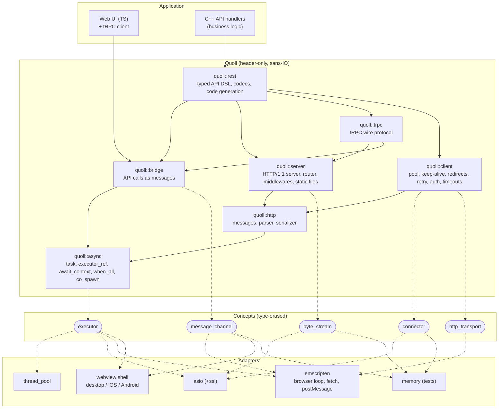
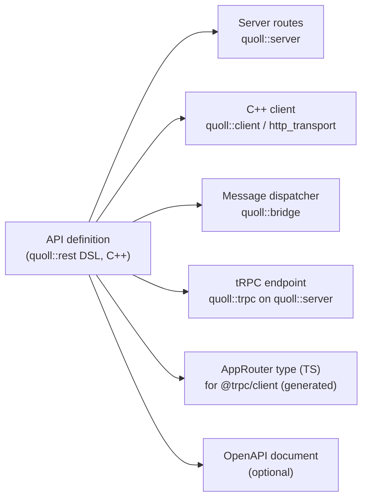
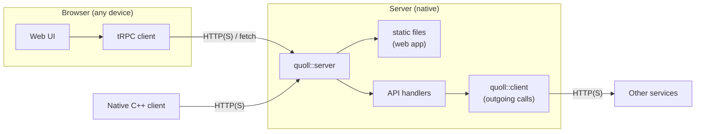
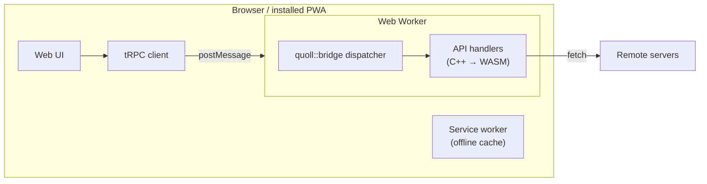
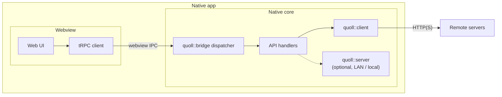
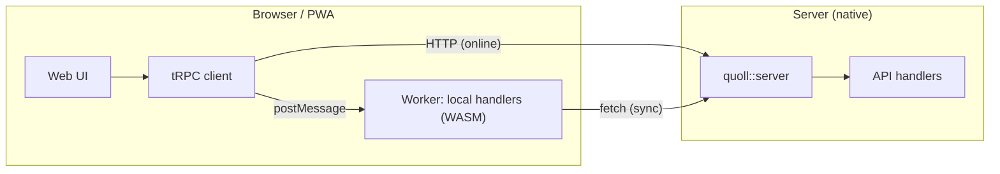
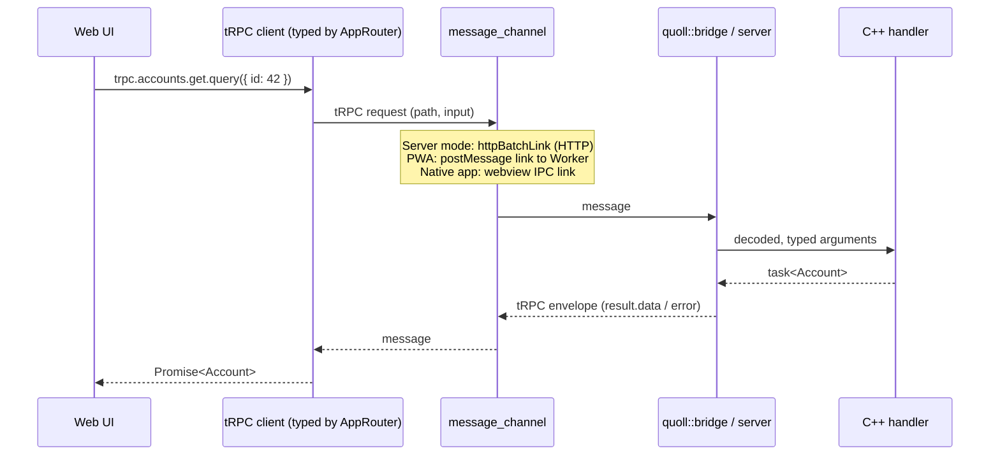
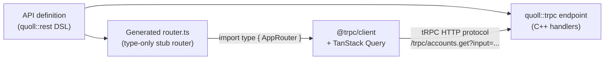

# Quoll — plan

Status: **exploration**, nothing decided beyond what is marked *Decided*. Last update: 2026-11-02.

## Goal

Quoll is the C++20 core of cross-platform applications: asynchronous HTTP **clients and servers** and typed REST
APIs, without doing any I/O itself (sans-IO). The UI is written once with web technologies and talks to the core only
through the typed API contract. The same application can be deployed as:

- a **native server + web app** (no WASM),
- a **standalone PWA** (core compiled to WASM),
- a **native app** (desktop / mobile webview shell + native core),

and any combination of them (e.g. an offline-capable PWA that syncs with a Quoll server).

## Decided

- Name: **Quoll**, a new public library (namespace `quoll::`, same name for the C++ package and the npm package of
  the TS side). It holds `async`, `http`, `client`, `server`, `rest` (DSL), `trpc` and `bridge`. Puffin keeps its
  existing utility modules (events, ioc, maths, imdb...). Repository: GitHub `4thlabs/quoll`.
- Header-only, C++20 minimum, rules in [`CODING_RULES.md`](CODING_RULES.md). Third-party C/C++ dependencies may be
  compiled targets fetched by CPM; Quoll's own code stays header-only.
- Prior art: the `claude/project-thread-*` branches of the Puffin repo (earlier `async`, `webkit`, `rest`) were
  removed from Puffin's `master` for quality reasons. Ideas only: never port code from them, rewrite to the rules.
- Type erasure: non-intrusive function-pointer tables, `xxx_ref` + `any_xxx` (see the rules).
- The HTTP client is in scope. Burl (CppAlliance) is not an option: it is tied to Corosio for sockets / TLS.
- HTTP layer: **own stack on llhttp** (option B of [HTTP layer](#http-layer)), decided on 2026-11-02. llhttp is
  fetched by CPM and compiled; `quoll::async` follows Capy's design without depending on it.
- WASM is a first-class target: the core never requires threads or blocking waits.
- The TS side of the API is **[tRPC](https://trpc.io/)** (v11): the server speaks the tRPC HTTP protocol and the
  DSL generates the `AppRouter` type, so a stock `@trpc/client` (and the React Query / TanStack integrations) is
  fully typed against the C++ API. See [tRPC compatibility](#trpc-compatibility).
- Main UI direction: **hybrid web UI** (see [UI](#ui-hybrid-web-model)). Qt is no longer a target: no Qt adapter in
  the plan.

## Architecture

### Layers



| Concept | Meaning | Implemented by |
|---|---|---|
| `executor` | where / when a coroutine resumes | thread pool, asio, browser event loop, shell main thread |
| `byte_stream` | `read_some` / `write_some` on raw bytes (`any_stream`, no allocation per operation) | asio sockets, memory |
| `connector` | `(host, port, tls) -> task<any_stream>` | asio (+ssl), memory |
| `http_transport` | `request -> task<response>`, for platforms that do HTTP themselves | `quoll::client` over a connector, browser `fetch` |
| `message_channel` | send / receive API messages between UI and core | `postMessage` (Worker), webview IPC, HTTP, memory |

Design references taken from Boost.Capy: `await_context` propagated through `await_suspend(h, env)`,
`executor_ref`, zero-allocation `any_stream`.

### One API definition, many outputs

The REST DSL is the contract between the UI and the core, and between processes. Everything else is generated from
it.



## UI: hybrid web model

The UI is a web app (HTML / CSS / TS). Text, IME, selection and accessibility come from the DOM. The tRPC client
exposes the same typed API in every mode; only its **link** (transport) changes.

### Deployment modes

#### 1. Native server + web app (no WASM)

The classic mode: a native Quoll server serves the web app assets and the API. Any browser on any device is a client;
native C++ programs can call the same API.



#### 2. Standalone PWA (core in WASM)

No server needed: the core runs in a Web Worker (keeps the UI thread free, works single-threaded). Installable,
offline-capable. The core can only be a client: outgoing calls go through `fetch`.



#### 3. Native app (webview shell + native core)

For capabilities the browser refuses: listening sockets, full file system, background work, threads. The shell is a
thin native window hosting a webview (desktop: a C++ webview library; mobile: a small Swift / Kotlin host).



#### 4. Combined: PWA + server

The PWA runs local logic in WASM (offline, instant) and syncs with a native Quoll server when online.



### Same call, three transports

The tRPC client and the C++ handler are identical; only the tRPC link and the `message_channel` differ.



### tRPC compatibility

tRPC is TypeScript-only: normally the client imports `typeof appRouter` from a TS server. Quoll replaces the TS
server with two generated pieces and keeps the client stock.



**Generated TypeScript.** A real `.ts` file built with `initTRPC`, whose procedures carry the types but no logic.
The client only does `import type`, so nothing of it ships at runtime. This uses tRPC's own types instead of a
hand-written `.d.ts`, which would depend on tRPC internals (`unstable-core-do-not-import`) that change between
releases.

```ts
// generated from the DSL: do not edit
import { initTRPC } from '@trpc/server';
const t = initTRPC.create();
const stub = <T>() => (): T => { throw new Error('type-only'); };

export interface Account { id: number; name: string; }

const appRouter = t.router({
  accounts: t.router({
    get: t.procedure.input((v: unknown) => v as { id: number }).query(stub<Account>()),
    rename: t.procedure.input((v: unknown) => v as { id: number; name: string }).mutation(stub<Account>()),
  }),
});
export type AppRouter = typeof appRouter;
```

Optionally the generator also emits Zod schemas, to validate inputs on the client and to use them as `.input(...)`.

**Server side (`quoll::trpc`).** Implements the tRPC v11 HTTP protocol on top of `quoll::server`:

- each DSL operation is a procedure: `query` (GET, input as JSON in `?input=`), `mutation` (POST, JSON body), and
  later `subscription` (Server-Sent Events, for `httpSubscriptionLink`);
- nested routers map to dotted paths (`accounts.get` → `/trpc/accounts.get`);
- batching: `?batch=1`, comma-separated paths, inputs keyed by index, array response, `207` on mixed statuses;
- envelopes: `{ "result": { "data": ... } }` and `{ "error": { "message", "code", "data": { "code", "httpStatus",
  "path" } } }`, with tRPC error keys (`BAD_REQUEST`, `NOT_FOUND`, ...) mapped to HTTP status and JSON-RPC codes;
- plain JSON first; a `superjson` transformer (dates, maps, bigints) only if needed;
- `allowMethodOverride` support (queries sent as POST).

**Other modes.** The same protocol envelopes travel over `message_channel`: a small custom tRPC link
(`postMessage` to the Worker in PWA mode, webview IPC in the native app) sends `{ path, type, input }` and the
`quoll::bridge` dispatcher answers with the same envelopes. The UI code does not change between modes.

**Consequences for the DSL.** tRPC is RPC, not REST: every operation needs a name, a kind (query / mutation /
subscription), an input type and an output type. The DSL can still generate REST routes and OpenAPI from the same
definitions for non-TS consumers.

**Risks.** The tRPC wire protocol is documented but evolves with major versions (v10 → v11 changed it): pin a
version and run the official client against the C++ server in CI. Type inference on very large routers can be slow
in the TS editor.

### Mode capabilities

| | Server + web app | PWA (WASM) | Native app (shell) |
|---|---|---|---|
| Install | none (URL) | from browser | store / installer |
| Offline | no | yes (service worker) | yes |
| Core runs | on the server | in a Web Worker | in the app process |
| Listen / serve | **yes** | no | yes (LAN / local) |
| Outgoing HTTP | `quoll::client` | `fetch` only | `quoll::client` |
| Threads | yes | optional (needs COOP / COEP) | yes |
| Multi-user | yes | no | no |

### Known limits

- Two languages: C++ core, TS UI.
- Webview engines differ: WebKit (iOS, macOS, Linux), Chromium (WebView2 on Windows, Android WebView). Test on each.
- iOS PWAs are restricted (storage eviction, background work): status to check.
- Bridge cost: every call is serialized. Large payloads need a binary encoding or shared buffers, not JSON.

### Long-term alternative: GPU-drawn UI in C++

Kept for later, not planned: a "modern Qt" assembled from SDL3 (platform, IME, lifecycle), WebGPU (Dawn natively,
browser API on the web), Skia or ThorVG + HarfBuzz (2D + text), Yoga (layout), AccessKit (accessibility), with
`quoll::async` driving the frame loop and reactive signals instead of moc. The hard, multi-year parts are text, IME
and accessibility on mobile and web, which the hybrid web model gets for free.

## WASM constraints

- **No sockets in the browser.** Outgoing HTTP uses the `http_transport` concept implemented with `fetch`; there is
  no server in the browser (WASI later).
- **Threads are optional.** The core (`async`, `http`, `rest`, `bridge`) must not require `std::thread`,
  `std::jthread` or blocking waits; threads only live in the thread pool adapter. Never `sync_wait` on the browser
  main thread.
- **Exceptions**: build with `-fwasm-exceptions`; keep hot paths on error codes / `results`.
- Every module builds and runs its tests under Emscripten in CI (headless Node runner).

## HTTP layer

| | A. Capy + Boost.Http | B. Own stack + llhttp |
|---|---|---|
| Parser / serializer | Boost.Http (sans-IO) | llhttp (Node.js parser, C, also used compiled to WASM by undici) + own serializer |
| Async foundation | Boost.Capy | `quoll::async`, Capy's design without the dependency |
| Maturity | Not in Boost yet, breaking changes weekly (Capy `refactor!` on 2026-10-30), Burl ships its own parser instead of Boost.Http's | llhttp stable for years |
| Dependencies | Boost (system, url, json...) | none besides llhttp |
| WASM | Unverified: Capy's `thread_pool` / `strand` use `std::thread`; no Emscripten support mentioned in either repo | llhttp is plain C, known to build to WASM |

Decision: **B** (2026-11-02).

## Prototype (next step)

Goal: validate the design with code. Success criteria:

1. A client GET, end to end, with llhttp + own serializer over a `byte_stream`.
2. Parser edge cases: `HEAD` responses, `1xx` / `100-continue`, close-delimited bodies, chunked with trailers.
3. An asio `connector` producing a type-erased stream.
4. The HTTP core compiles with Emscripten; a `fetch`-based `http_transport` runs the same call in Node.
5. One API defined with the DSL, the generated `AppRouter`, called with a stock `@trpc/client` from the same web
   page in three modes:
   native server (`httpBatchLink`), PWA (Quoll in a Worker, `postMessage` link), native webview shell (IPC link).
   Errors, batching and type checking (`tsc` fails on a wrong input type) must work.

## Environment

- Dev container (`.devcontainer/`): Ubuntu 24.04, GCC 13, Clang 18, CMake / Ninja / ccache, OpenSSL, Emscripten SDK
  (`EMSDK_VERSION`, default `latest`), Node.js (`NODE_MAJOR`, default 24).
- Agent machine: no local toolchain. Docker goes through the docker-in-docker daemon `DOCKER_HOST=tcp://orca-dind:2375`
  (the local socket is not accessible). The image builds there (`docker build -t quoll-dev .devcontainer`), but the
  daemon does not see `/home/orca`: bind mounts are empty, so the sources are streamed in with `tar` and
  `devcontainer up` does not work as is.
