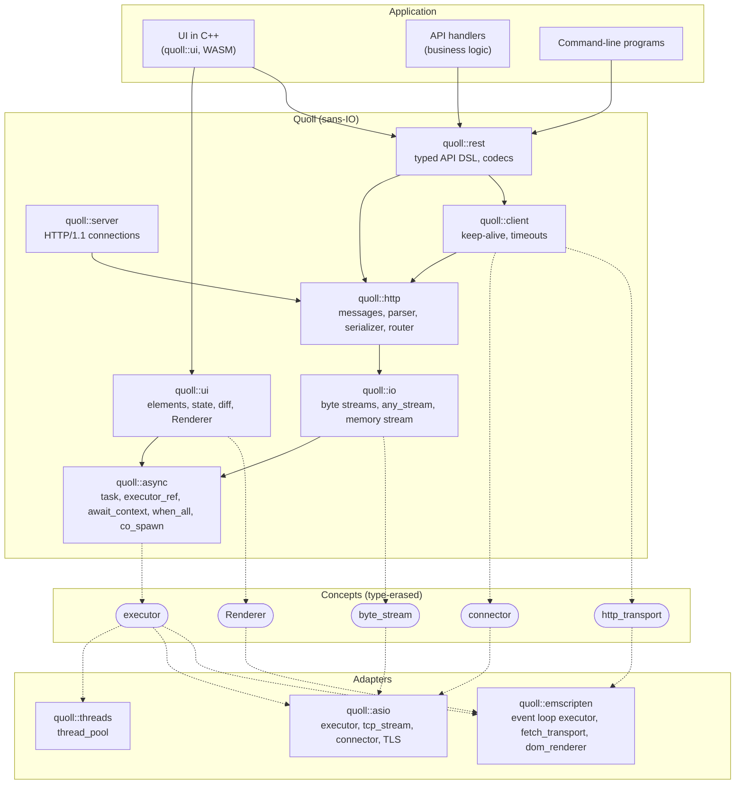

# Quoll — plan

Last update: 2026-11-04. The [roadmap](#roadmap) says what comes next, and is the reference for the order of the work.

## Target

A C++ web framework aimed at **performance and ease of use**, in three parts that work apart or together:

- **Client and server:** HTTP over any runtime, secure, streaming and fast, with SSE and WebSocket.
- **REST:** an API described once with the DSL, then served or called, from a command-line program as from anywhere
  else, with a runtime (asio, or another).
- **UI:** a C++ DSL compiled to WASM (the Emscripten runtime), which gives one application for web, desktop and mobile.
  Styled with Tailwind, with base components provided and hot reload. Quoll drives the tools, Vite among them, and not
  the reverse.

Build time and hot reload are kept short and measured all along.

## Roadmap

One pull request per topic, under the rule in [`AGENTS.md`](../AGENTS.md). A new public API is shown to the maintainer
before much is built on it. Points marked "To settle" and the [open questions](#open-questions) are the maintainer's to
decide. Steps marked *(maintainer merges)* are big architecture changes. Figures given as "today" were measured when this
roadmap was written.

**Current step: 0.**

### Done

`async`, `io`, `http`, `client`, `server` and `rest`, with timeouts by default and TLS (a client GET and a REST client
over TCP, over `fetch`, and through OpenSSL). A first `quoll::ui` with its DOM renderer, Tailwind through Vite, and two
levels of hot reload, in the sample `ui_notes`. In CI: `clang-tidy`, the standard library's checks, Codex's review and a
protected `main`.

Measured on `ui_notes`: 51 KB of gzipped WASM with the REST client, against about 45 KB for React and ReactDOM alone; a
literal shows in about 31 ms, keeping the state; any other change in a page builds in about 1 s and reloads the page in
about 1.2 s.

### Step 0: finish the setup

Small, process only.

- A `macos-latest` CI job (Apple Clang, libc++): nothing native has ever run on the maintainer's Mac. Not required until
  it passes, so that it blocks nobody meanwhile. What it finds says whether Apple Clang becomes a supported compiler, for
  the maintainer to settle.
- Maintainer: delete the secret `CLAUDE_CODE_OAUTH_TOKEN`, and decide on the `quoll-ui-demo` container. The branch `ui-ipp`
  stays, for step 1.

*Done when:* the Mac job runs in CI, either passing and required or with what breaks listed.

### Step 1: compiled libraries *(maintainer merges)*

First, as all later code is then written for it. Decided on 2026-11-04, for applications that stay reliable over time.

- `src/*.cpp` and one mode, like Capy and Corosio, rather than the two modes of `.ipp` files. Templates over application
  types stay in headers.
- In order: the rules and `quoll::ui`, starting from the `app_core` / `renderer_ref` split on the branch `ui-ipp`; then
  `http`; then `server` and `client`; then the adapters, hiding asio and OpenSSL from application headers if that holds.
- The global state of hot reload (`hot()`) moves to a source file, which settles the review point left open on #39.

*Done when:* application code is unchanged (a `main.cpp` and headers), and each pull request gives before and after
figures for a full build, a page rebuild (about 1 s today) and the size of the WASM (51 KB gzipped today).

### Step 2: client and server, security and completeness

**To settle at its start:** this plan has assumed a reverse proxy in front, and security is now part of the target. If
Quoll may be exposed directly, `Expect: 100-continue` (the parser stopping after the header), a lingering close after an
error response and TLS's closing message join this step; the last two need a half-close in `ByteStream`.

- Limits and shutdown: graceful shutdown (requests under way finish, within a time limit), a connection limit, limits on
  headers and bodies, the timer of the connections on a thread pool, which `serve` can hand them from its own loop.
- Reliability, in the manner of Rust. C++ has no borrow checker, but types and tools give a good part of what it
  guarantees:
  - `QUOLL_LIFETIMEBOUND` (`[[clang::lifetimebound]]`) on the functions returning views, and `[[clang::coro_return_type,
    clang::coro_lifetimebound]]` on `async::task`, with `-Werror=dangling` on the Clang job: Clang refuses some dangling
    references. The macro only hides an attribute from GCC, so the coding rules have to allow it.
  - `synchronized<T>`, a mutex holding its data, where a mutex sits next to what it protects (`connection_pool`,
    `task_group`). It takes a function rather than handing out a guard, and refuses a function returning something to
    await, as a lock held across a `co_await` would be unlocked from another thread. Clang's `-Wthread-safety` may do
    this at compile time, with no new type: compare them first.
  - `cppcoreguidelines-avoid-capturing-lambda-coroutines` in `clang-tidy`, if it can be kept quiet: coroutine lambdas
    with captures are a pattern here, kept alive by the app.
- Fuzzing in CI, under ASan and UBSan: `serve_connection` over a memory stream, the router, the REST decoding (path and
  query parameters, JSON bodies through Glaze). A client parses what any server sends, so its exchange and the decoding
  of REST responses too.
- Features: server middlewares and static files; client redirects, a connection limit per transport, a path prefix in
  the base URL. A client's `response_timeout` applies per attempt, so a deadline over the whole `send` if that proves
  confusing.

What stays out of reach: the lifetimes of coroutines remain mostly documented rules ("`router` outlives the task", when
the task outlives the line it was made on), a use after move across functions or through a member goes unseen, and a
lambda can still capture by reference what dies before it.

*Done when:* the question above is settled and what it brings is done, the fuzz targets run in CI with no open crash, the
limits, the shutdown and the features are tested, and the reliability points are in place or dropped with a reason.

### Step 3: streaming

- First pull request: a benchmark harness (requests per second, latency, allocations per request) and its baseline, as
  streaming touches the hot paths.
- Streamed request and response bodies, on the server, the client and browser `fetch`.
- A limit on progress or a minimum rate, as the read and write timeouts now cover a message as a whole, which ends a
  legitimate transfer on a slow link (8 MiB in 30 s is about 2.2 Mbit/s). The same goes for static files.
- A half-close in `ByteStream`, if step 2 did not bring it.

*Done when:* a transfer far larger than memory runs in bounded memory, on both sides, with the figure measured.

### Step 4: performance

Only what the harness shows. Candidates:

- Each bounded phase allocates coroutine frames and an asio timer, about three times per request on the server. A timer
  per connection avoids it.
- A client copies the request body into the serialized message: write the head and the body as two buffers.
- A TLS client builds its context per connection, and resumes no session.
- Idle connections are only found closed when a request uses them: closing them after an idle time, and letting a POST
  reuse one, which needs a stream that tells a closed peer before writing.

*Done when:* figures are published against the baseline, and each change is justified by a measure.

### Step 5: REST from a command-line program

The DSL and a runtime, with no UI.

- On the client: `scope<Api>(prefix arguments...)`, and interceptors around `send` (retry, token refresh on 401).
- Third-party APIs, as [the REST DSL](#rest-dsl-contract-server-client) describes: renamed fields, unknown fields, error
  bodies of any shape, codecs. A contract alone, with no Quoll server in the program.
- A sample and a guide for a command-line program.
- After this, and optional: an OpenAPI document generated from the DSL, to document an API or for third-party clients,
  and a generator of contracts from existing documents.

*Done when:* a real third-party API is called from a command-line program, natively and through `fetch_transport`, with
`call`, `try_call` and credentials.

### Step 6: SSE, then WebSocket

- SSE first, as it rests on step 3: a DSL route kind returning typed events, a client, the browser. The browser reads a
  streamed `fetch` rather than `EventSource`, which takes no headers: an API with credentials could not use it.
- WebSocket: the upgrade, frames, a client, the browser adapter, its shape in the DSL.

*Done when:* each runs end to end, natively and in the browser, with its frame parsing fuzzed.

### Step 7: the UI DSL, complete

- Nested stateful components: a component is the root of an app for now.
- Restoring the states after a rebuild, which the third level of hot reload still lacks.
- How a page writes its names: `using namespace quoll::ui;` now sits in each `view()`, as the rules forbid it at
  namespace scope in a header.
- Base components, styled with Tailwind.
- In the sample: adding a note during the first load can hide it until a reload.
- A trial on a real screen of an application, chosen with the maintainer at the start of this step.

*Done when:* that screen runs with the base components, with what it lacks listed.

### Step 8: the `quoll` command, driving Vite *(maintainer merges the first pull request)*

**To settle at its start:** a native binary, or an npm package (`npx quoll`), as Node is needed for Vite anyway and it
avoids a binary per platform. The commands are shown to the maintainer first.

```bash
quoll new my_app
cd my_app
quoll dev      # build, watch, Vite, hot reload
quoll build    # dist/
```

- The plugin leaves the sample, with its scanner tested in CI. Vite and Tailwind's setup become internal, and an
  application writes neither.
- Its limits as a prototype: a failed first build stops the server, a Vite restart during a build can run two builds in
  one directory, an error with no page open can show once on the next page, and a multi-line macro holding a tag is not
  told apart.
- Build time and hot reload, measured, with a target set at the start of this step from the figures of step 1.

*Done when:* a new project reaches a running page with hot reload through these commands, and `samples/ui_notes` uses
them.

### Step 9: desktop and mobile *(maintainer merges)*

- A PWA first, then a webview shell on desktop, then on mobile, all loading the same WASM.
- Native capabilities (files, sockets) through a small gateway, designed at this step. The webview library is to be
  chosen.
- Installed PWAs are restricted on iOS (storage eviction, background work), and webview engines differ: WebKit on iOS,
  macOS and Linux, Chromium on Windows and Android. To check on each.

*Done when:* the sample runs on each target, with the differences between engines listed.

## Decided

- Name: **Quoll**, a new public library (namespace `quoll::`). Puffin keeps its existing utility modules (events, ioc,
  maths, imdb...). Repository: GitHub `4thlabs/quoll`.
- Header-only until [step 1](#step-1-compiled-libraries-maintainer-merges), **C++23** minimum (GCC ≥ 13, Clang ≥ 19;
  C++20 until 2026-11-03, raised for Glaze), rules in [`CODING_RULES.md`](CODING_RULES.md). Third-party C/C++
  dependencies may be compiled targets fetched by CPM.
- The UI is a **C++ DSL compiled to WASM** (2026-11-04), which replaces the React, TypeScript client and `quoll::bridge`
  of the earlier plan: elements with pipes and class strings (`button("Add") | tw("btn") | on_click(...)`), components
  as aggregates holding `state<T>` members rather than functions with hooks, a view that runs again and a diff that
  reaches a `Renderer`.
- **The same WASM everywhere** (2026-11-04): web and PWA first, then a webview shell on desktop and mobile.
- **Quoll drives the tools** (2026-11-04), through a `quoll` command: Vite becomes an internal detail. Replaces a
  development driven by Vite and a release driven by CMake.
- **Compiled libraries** (2026-11-04), in one mode rather than the two of `.ipp` files, for applications that stay
  reliable over time: see [step 1](#step-1-compiled-libraries-maintainer-merges).
- OpenAPI (2026-11-04) is an optional, later output of the REST DSL, no longer the contract of the UI.
- JSON: [Glaze](https://github.com/stephenberry/glaze) (2026-11-03), header-only, fetched by CPM with a pinned version.
  Its aggregate reflection also serves the REST DSL (see [REST DSL](#rest-dsl-contract-server-client)).
- REST DSL (2026-11-03, see [REST DSL](#rest-dsl-contract-server-client)): one `endpoint<"name", method, "/path", parts...>`
  alias per operation, nested `api<>`, `with<>`, overload set services, `call` / `try_call` / `scope` clients, one typed
  response per status, `query_params<Struct>`, Glaze's aggregate reflection instead of macros, a client over
  `http::HttpTransport`, routes in the sans-IO router. A contract stands alone: clients of third-party APIs need no Quoll
  server.
- Prior art: the `claude/project-thread-*` branches of the Puffin repo (earlier `async`, `webkit`, `rest`) were removed
  from Puffin's `master` for quality reasons. Ideas only: never port code from them, rewrite to the rules.
- Type erasure: non-intrusive function-pointer tables, `xxx_ref` + `any_xxx` (see the rules).
- The HTTP client is in scope. Burl (CppAlliance) is not an option: it is tied to Corosio for sockets / TLS.
- HTTP layer: **own stack on llhttp** (option B of [HTTP layer](#http-layer)), decided on 2026-11-02. llhttp is fetched
  by CPM and compiled; `quoll::async` follows Capy's design without depending on it.
- WASM is a first-class target: the core never requires threads or blocking waits.

## Architecture

### Layers



| Concept | Meaning | Implemented by |
|---|---|---|
| `executor` | where / when a coroutine resumes; `post(work_item &)` links an intrusive node, no allocation | thread pool, asio, browser event loop |
| `byte_stream` | `read_some` / `write_some` on raw bytes (`any_stream`, no allocation per operation) | asio sockets, memory |
| `connector` | `(host, port, tls) -> task<any_stream>` | asio (+ssl), memory |
| `http_transport` | `request -> task<response>`, for platforms that do HTTP themselves | `quoll::client` over a connector, browser `fetch` |
| `Renderer` | what the diff of a view changes: nodes, classes, attributes, listeners | the DOM, memory in tests |

The router lives in `quoll::http` and does no I/O: it maps a method and a path template to a handler `request ->
task<response>`. `quoll::rest` registers the DSL routes in it, and `quoll::server` feeds it the requests read from
connections.

Design references taken from Boost.Capy: `await_context` propagated through `await_suspend(h, env)`, `executor_ref`,
zero-allocation `any_stream`.

Program entry point (2026-11-03): application code names no adapter. `main()` creates the build's runtime
(`quoll::runtime`, the adapter chosen with `QUOLL_RUNTIME`, asio natively), spawns the program's main coroutine on it
(`co_spawn(runtime.get_executor(), task, quoll::async::detached, runtime.get_stop_token())`, the token stopped by
Ctrl-C) and runs it; servers, clients and their connections live in that coroutine. Executors carry the services of
their loop (`executor.query<io::network_ref>()`), so `io::connect` / `io::listen`, `server::listen(router, port)` and
`rest::client<api>{"http://host:port"}` need no executor, connector or acceptor handed to them.

Time (2026-11-04): a timer is one more service of the executor (`executor.query<async::timer_ref>()`), a `steady_timer`
natively and `setTimeout` in the browser. Applications call `async::sleep_for(duration)` and
`async::with_timeout(duration, task)`. A timeout stops the task and awaits its end: nothing it refers to is left behind,
so a task only ends early if it observes its stop token. Its `operation_canceled` then becomes `timed_out`; a task that
finishes anyway still gives its result. The server and the client have timeouts by default (server: idle 60 s, read and
write 30 s; client: connect 30 s, response 60 s), which zero disables. They do not apply on an executor without a timer.

TLS (2026-11-04): one more service of the executor (`io::tls_network_ref`), through `asio::ssl` and OpenSSL. `https://`
checks the server against the system's authorities and its name by default; `.tls = {.ca_file = ...}` trusts a private
authority, `.tls = {.verify_peer = false}` turns the check off. `listen` takes `.tls = {.certificate_file = ...,
.private_key_file = ...}`. OpenSSL is detected when configuring (`QUOLL_TLS`: `AUTO`, `ON`, `OFF`): without it, what
needs TLS throws at run time, saying so. A server's handshake takes place on the connection's first read, so that a slow
peer holds nobody back and the idle timeout covers it. In a browser, `fetch` does it all.

### REST DSL: contract, server, client

What this section says of OpenAPI (operation ids, security schemes, JSON Schemas) describes the optional output of
[step 5](#step-5-rest-from-a-command-line-program), which does not exist yet: it binds nothing else.

An API description is a **contract**: C++ types, with no I/O and no server or client code. A server implements a
contract and a client consumes one, but neither needs the other. Describing a third-party API (a payment provider, a
public service, another team's service) means writing only its contract, then calling it with a client: no Quoll
server is involved. The shape comes from the `rest` module of Puffin's `claude/project-thread-*` branches (ideas
only, see [Decided](#decided)), adjusted for OpenAPI, typed errors and third-party APIs.

**Describing an API.** One type alias per operation:

```cpp
namespace rest = quoll::rest;

namespace bank {

struct user {
  std::int64_t id = 0;
  std::string name;
  std::optional<std::string> email;
};

struct new_user {
  std::string name;
  std::string email;
};

struct user_filter {
  std::optional<int> limit;
  std::optional<std::string> name;
};

namespace users {
using namespace quoll::rest;
using quoll::http::verb;

using list = endpoint<"users.list", verb::get, "/", query_params<user_filter>, returns<std::vector<user>>>;
using get = endpoint<"users.get", verb::get, "/{id:int64}", returns<user>, returns<problem, status::not_found>>;
using create = endpoint<"users.create", verb::post, "/", body<new_user>, returns<user, status::created>,
                        returns<problem, status::conflict>>;
using remove = endpoint<"users.remove", verb::delete_, "/{id:int64}">; // 204

using api = rest::api<"/users", list, get, create, remove>;
} // namespace users

using v1 = rest::api<"/api/v1", auth::api, rest::with<rest::security<rest::bearer_auth>, users::api, cards::api>>;

} // namespace bank
```

- `endpoint<"name", method, "/path", parts...>`: the name is mandatory and unique in its API, which is checked at
  compile time. It is the OpenAPI `operationId` and the name of the route on the server. The method is an
  `http::verb` value, not a bare `GET` / `DELETE`: those are macros on some platforms (`DELETE` in `<winnt.h>`), and
  the rules allow no macro of our own.
- Path parameters are typed in the template, `{name:type}` (`int`, `int64`, `uint64`, `double`, `bool`, `string`
  by default, `path` for the rest of the path), and parsed at compile time.
- Parts:
  - `query<"name", T>`: `T` is the argument type. `query<"limit", std::optional<int>>` is optional (not required in
    the document, omitted from the URL when empty), `query<"tag", std::vector<std::string>>` repeats the parameter
    (`?tag=a&tag=b`), anything else is required. `header<>` follows the same rule, as do the fields of
    `query_params<Struct>`.
  - `query_params<Struct>`: each field of the struct is a query parameter. This is for operations with many optional
    parameters, common in third-party APIs; the call then uses designated initializers. A name of its own: a class
    template cannot also take the `<"name", T>` form of `query`.
  - `header<"Name", T>` and `body<T, Codec>`.
  - `returns<T, status, Codec>`: repeatable, one per status, each with its own type (200 by default). An endpoint
    without `returns` answers 204.
- `api<"/prefix", ...>` nests APIs, and a prefix may have parameters. `with<parts..., apis...>` adds parts to every
  endpoint of the APIs it wraps.
- Security schemes: `api_key<"Header">`, `api_key_query<"param">`, `bearer_auth`, mapped to OpenAPI
  `securitySchemes`. They are not arguments: the server checks them with validators, and the client sends the
  credentials it was given for each scheme.
- `param_traits<T>` converts path, query and header values to and from text; enums go by name.

Arguments are the same on both sides: the path parameters (prefixes first), then the parts in order, then the parts
inherited from `with<>`. The endpoint computes their types: `call` and the service take exactly those, not deduced
`Args&&...`, so that a braced list (`{.limit = 20}` for a `query_params<Struct>`) converts to its parameter.

**Serving it.** A service is an overload set, one `operator()(Endpoint, args...)` per endpoint, with no base class.
A missing service, or one with the wrong arguments, is a compile error.

```cpp
namespace bank {

struct users_service {
  task<std::vector<user>> operator()(users::list, user_filter filter);
  task<rest::reply<users::get>> operator()(users::get, std::int64_t id);
  task<user> operator()(users::create, new_user created);
  task<> operator()(users::remove, std::int64_t id);
};

} // namespace bank

http::router router;

rest::mount<bank::v1>(router, bank::auth_service{}, bank::users_service{}, bank::cards_service{},
                      rest::validators([&](rest::bearer_token const &token) { return sessions.valid(token); }));
```

- A service returns the type of the first `returns`, or `rest::reply<E>`, which holds any declared response with its
  status: built from a value whose type only one response has, or from `rest::respond<Status>(value)` when several share
  it. An undeclared status, or the wrong type for a status, does not compile. Only the endpoint's own responses: those
  inherited from `with<>` are the server's (credentials, errors).
- Errors without a declared response:
  - 400 for an invalid argument or body, 415 for a wrong `Content-Type`, 401 for missing or rejected credentials.
  - `throw rest::http_error(status, detail)` answers that status as `application/problem+json`.
  - Any other exception answers 500 without detail.
- `mount` registers the routes in the sans-IO `quoll::http` router, which `quoll::server` feeds. Middlewares (logs,
  metrics, auth beyond the schemes) wrap the router.

**Calling it.** A client takes the contract and an `http::HttpTransport`: `fetch_transport` in the browser, a Worker
or Node, and the `quoll::client` transport over a connector natively. The base URL belongs to the transport.

```cpp
using quoll::emscripten::fetch_transport;

rest::client<bank::v1, fetch_transport> api{fetch_transport{"https://bank.example.com"}};

api.credentials<rest::bearer_auth>(token);

bank::user found = co_await api.call<bank::users::get>(42);
auto maybe = co_await api.try_call<bank::users::get>(7);
auto page = co_await api.call<bank::users::list>({.limit = 20});
auto alice_cards = api.scope<bank::cards::api>(1); // fixes {user_id}
```

- `call` returns the first declared response. Any other outcome throws `rest::http_error` with the status and the
  detail of the server's problem, if any; another declared response is read with `try_call`.
- `try_call` returns `rest::result<E>`, `std::expected<rest::reply<E>, rest::unexpected_response>`: the declared
  response received, or the whole response with why it is unexpected (an undeclared status, a body that does not
  decode).
- Transport failures (network, cancellation) stay exceptions from the task in both cases (`std::system_error`).
- The client is a template over its transport: no virtual call. Type erasure, if a use needs it, goes through
  function-pointer tables, like `any_stream`.
- Interceptors (retry, token refresh on 401) wrap `send`.
- Arguments are taken by value, as the endpoint's types, and live in the task.

**Third-party APIs.** A contract written for someone else's API must express what that API does, not what Quoll
would choose:

- JSON names that are not C++ names (`created_at`, `htmlUrl`, reserved words), through a per-type renaming trait.
- Unknown fields are ignored. An enum may declare an enumerator for the values it does not know.
- Error bodies of any shape, one type per status (`returns<github_error, status::not_found>`), not only `problem+json`.
- Bodies other than JSON through codecs: text, form, bytes.
- Later: a tool generating the contract header from an existing OpenAPI document. The DSL stays able to express what
  such documents commonly hold.

**Types, JSON and schemas.** Bodies are plain aggregates, read and written by
[Glaze](https://github.com/stephenberry/glaze). Its aggregate reflection gives their fields with no macro and no
declaration, and the DSL uses the same reflection for the fields of `query_params<Struct>` and for the JSON Schema
of `components/schemas`.

- A `glz::meta<T>` specialization renames fields (`created_at`, reserved words), maps enums to names, and describes
  the types that are not aggregates: a class with invariants, a third-party type.
- Decoding errors come back as values (Glaze's `expected`): the server answers 400 with them, and `try_call` reports
  them.
- The client skips unknown keys when it decodes the responses of a third-party API (`error_on_unknown_keys`
  off); Quoll's server may keep rejecting them in requests.
- Reflected types need external linkage: Glaze reads field names through an `extern` object, which Clang rejects
  for a type in an anonymous namespace.
- The DSL writes the JSON Schemas itself, from the same reflection. Glaze 9.1's own JSON Schema does not serve
  `components/schemas` as is: no `required` list, named types inlined instead of `$ref`, 64-bit integers as a
  `minimum` / `maximum` range instead of `format: int64`.

### UI DSL

`quoll::ui` is written in C++ and compiled to WASM, in the same language as the rest of an application. The DOM gives
text, IME, selection and accessibility; Tailwind gives the styles.

```cpp
struct counter {
  state<int> count;

  element view() {
    using namespace quoll::ui;

    return div({
               text("Count: " + std::to_string(*count)) | tw("text-lg"),
               button("Add") | tw("btn btn-primary") | on_click([this] { count = *count + 1; }),
           }) |
           tw("flex items-center gap-2");
  }
};

int main() { quoll::emscripten::mount<counter>(); }
```

A state changing runs the view again; the diff reaches a `Renderer`, the DOM in a page. Handlers are plain functions or
tasks, and call a REST API through a `rest::client` over `fetch_transport`.

### Development tools

Hot reload has three levels, from the cheapest:

1. CSS, through Vite and Tailwind's plugin, which reads the C++ for class names.
2. A literal of `tw()`, `text()` or a tag, sent to the running program with no compilation, keeping its state.
3. Anything else: a rebuild, then the page reloads. A compilation error shows in Vite's overlay. Restoring the states is
   [step 7](#step-7-the-ui-dsl-complete).

For now this is a plugin of the sample `samples/ui_notes`, driven by Vite; [step
8](#step-8-the-quoll-command-driving-vite-maintainer-merges-the-first-pull-request) turns it around.

## WASM constraints

- **No sockets in the browser.** Outgoing HTTP uses the `http_transport` concept implemented with `fetch`; there is no
  server in the browser (WASI later).
- **Threads are optional.** The core (`async`, `http`, `rest`, `ui`) must not require `std::thread`, `std::jthread` or
  blocking waits; threads only live in the thread pool adapter (`quoll::threads`). Never `sync_wait` on the browser main
  thread.
- **Exceptions**: build with `-fwasm-exceptions`; keep hot paths on error codes / `results`.
- Every module builds under Emscripten in CI and runs its tests there (headless Node runner), except the thread pool
  tests: the CI build has no pthreads.

## HTTP layer

| | A. Capy + Boost.Http | B. Own stack + llhttp |
|---|---|---|
| Parser / serializer | Boost.Http (sans-IO) | llhttp (Node.js parser, C, also used compiled to WASM by undici) + own serializer |
| Async foundation | Boost.Capy | `quoll::async`, Capy's design without the dependency |
| Maturity | Not in Boost yet, breaking changes weekly (Capy `refactor!` on 2026-10-30), Burl ships its own parser instead of Boost.Http's | llhttp stable for years |
| Dependencies | Boost (system, url, json...) | none besides llhttp |
| WASM | Unverified: Capy's `thread_pool` / `strand` use `std::thread`; no Emscripten support mentioned in either repo | llhttp is plain C, known to build to WASM |

Decision: **B** (2026-11-02).

## Open questions

Those not settled by a step of the roadmap:

- The runtime in a browser, where the event loop already runs: no `run()` there, and tasks start with `co_spawn` on the
  event loop. The default `rest::client` transport there would be `fetch`.
- A default `main()` provided by Quoll, creating the runtime and running an application coroutine, once the shape of
  that coroutine (arguments, exit code) is settled.
- If OpenAPI comes back: the C++ → JSON Schema mapping, 64-bit integers in particular.
- A batch endpoint, only if a real need shows up.

## Environment

- Scaffolding: `quoll new` in [step 8](#step-8-the-quoll-command-driving-vite-maintainer-merges-the-first-pull-request),
  rather than a template in cpp-init.
- Dev container (`.devcontainer/`): Ubuntu 24.04, GCC 13, Clang 19, CMake / Ninja / ccache, OpenSSL, Emscripten SDK
  (`EMSDK_VERSION`, default `latest`), Node.js (`NODE_MAJOR`, default 24).
- Agent machine: no local toolchain. Docker goes through the docker-in-docker daemon `DOCKER_HOST=tcp://orca-dind:2375`
  (the local socket is not accessible). The image builds there (`docker build -t quoll-dev .devcontainer`), but the
  daemon does not see `/home/orca`: bind mounts are empty, so the sources are streamed in with `tar` and `devcontainer
  up` does not work as is.
