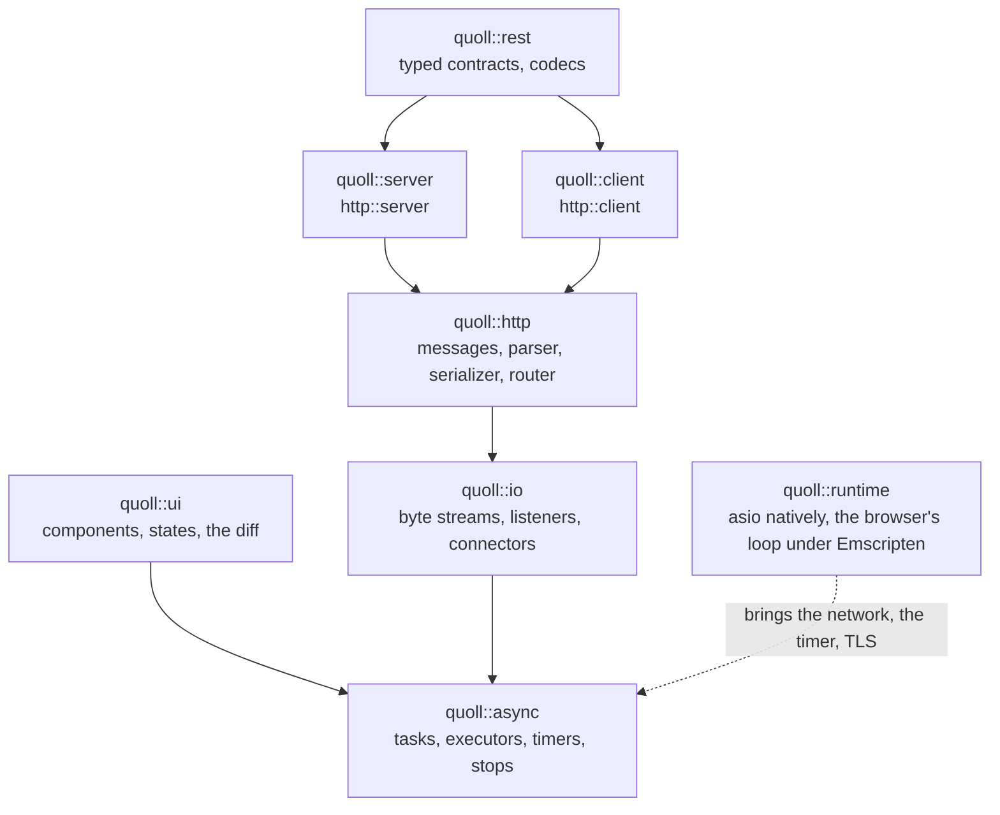

# Concepts

What to know of how Quoll works before the guides: how its modules fit, where the I/O happens, what a program runs on,
and the few rules every part follows. The reasons behind them are in [Design decisions](design-decisions.md).

## The modules



Each module is a library, `quoll::<module>` in CMake, with an umbrella header (`<quoll/http.hpp>`) and one header per
component (`<quoll/http/router.hpp>`). Linking one brings those it depends on. `quoll::server` and `quoll::client` are
libraries of their own, so that a program links only what it uses, and their names are in `quoll::http`:
`http::server`, `http::client`.

## Sans-IO

The HTTP parser, the serializer, the router, the server-sent events and WebSocket frames do no I/O: they turn bytes into
messages and messages into bytes. What reads and writes is a byte stream:

- **A connection is served over any `io::ByteStream`**: TCP, TLS, or the in-memory stream of a test, by the same code.
  A server and a client can talk over memory in a test, with no socket and no port.
- **A client goes through a `http::HttpTransport`**: natively, connections it opens through a connector; in a browser,
  `fetch`. The code calling it is the same.
- **A UI's view goes to a `ui::Renderer`**: the DOM in a browser, a tree in memory in a test, HTML with `to_html`.

| Concept                          | What it does                                                  | Given by                                         |
| -------------------------------- | ------------------------------------------------------------- | ------------------------------------------------ |
| `async::Executor`                | Where and when a coroutine resumes                            | asio, the browser's event loop, `async::run_loop` |
| `io::ByteStream`                 | Reads and writes bytes                                        | TCP and TLS sockets, the memory stream           |
| `io::Connector`, `io::Listener`  | Opens a stream to a host, accepts streams on a port           | asio                                             |
| `http::HttpTransport`            | Sends a request, gives its response                           | `http::client`, `fetch`, `http::local_transport` |
| `ui::Renderer`, `ui::WidgetRenderer` | Shows what a view changes, and its JavaScript widgets     | the DOM, memory in tests                         |

## What a program runs on

A program runs on a runtime: `quoll::runtime`, asio natively, the browser's event loop under Emscripten.

```cpp
int main() {
  quoll::runtime runtime;

  return runtime.run(serve());
}
```

- **The executor carries the services of its loop**: the network, the timer, TLS, blocking work, and `fetch` in a
  browser. So `http::server`, `http::client` and `async::sleep_for` ask for no executor, connector or acceptor: they
  find what they need on the executor of the task they run in.
- **An adapter brings those services**: `quoll::asio` and `quoll::emscripten`. A program rarely names one: it uses
  `quoll::runtime`, the adapter of its build. See [Runtimes](runtimes.md).
- **What does I/O lives in the tasks**, not in `main()`: a server, a client and their connections are locals of the
  program's main coroutine.

## Tasks and stops

- **`async::task<T>` is lazy**: it starts when awaited, as a temporary (`co_await std::move(work)` for one held by
  name), and runs on its awaiter's executor.
- **It ends in one of three ways**: with its value, with an exception, thrown again where it is awaited, or on a stop.
- **A stop is no exception**: nothing of the task resumes, no `catch` sees it, and its frame is destroyed, its locals
  with it. Code that must still run once stopped asks for the stop with `async::stopped_as_optional`.
- **`async::co_spawn`** runs a task beside the others, and gives what comes of it to a handler, which has a case for
  each of the three ends.

The [Async](async.md) guide says how to combine tasks, time them out, and stop them.

## The rules every part follows

- **What outlives a call owns what it needs.** The API keeps no reference you have to keep alive: a server copies its
  router, a client its options, a callback its arguments. The exceptions say so in their names: an `xxx_ref` refers to
  what you keep, a view (`std::string_view`, `std::span`) lives as long as its call, and an operation refers to the
  object it acts on, as `http::read(stream, ...)` does to its stream, awaited at once.
- **Failures the caller cannot foresee are exceptions**, derived from the standard ones: `std::system_error` with a code
  such as `std::errc::timed_out` or `std::errc::connection_refused`, `std::invalid_argument`, `std::logic_error` for a
  misuse. What is expected to fail, as parsing what a user typed, gives a `std::optional` or a result to look at.
- **Safe by default.** Timeouts and size limits are on, a stop shuts a server down gracefully, `https://` checks the
  server's certificate, and what must not compile, as a REST call with the wrong arguments, does not.

## Threads

- **One thread by default.** `quoll::runtime` runs its tasks on the thread that calls `run()`.
- **Several, if asked** (`runtime_options::threads`): the tasks of one connection then take turns on a strand, so that
  a handler needs no lock for what belongs to its connection. What tasks of several connections share is yours to
  protect. See [Runtimes](runtimes.md#several-threads).
- **Blocking work** goes to `async::offload`, which runs it on a thread of the runtime's own and resumes the task once
  it is done.
- **A UI app** runs on one executor, one thing at a time: its components need no lock.

## WebAssembly

Quoll's core needs no thread and no blocking wait, so the same code runs in a browser:

- the runtime is the page's event loop, and `run()` returns at once, as the loop goes on once `main()` has returned;
- a client goes through `fetch`, so the browser's own rules apply: CORS, its cookies, its TLS;
- a coroutine resuming another relies on WebAssembly's tail calls, which every browser of late 2024 has.

[Runtimes](runtimes.md#what-webassembly-asks-of-you) says what else differs.
