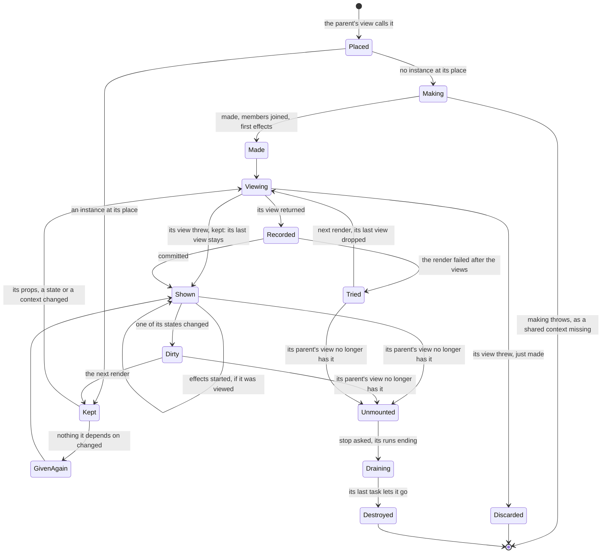
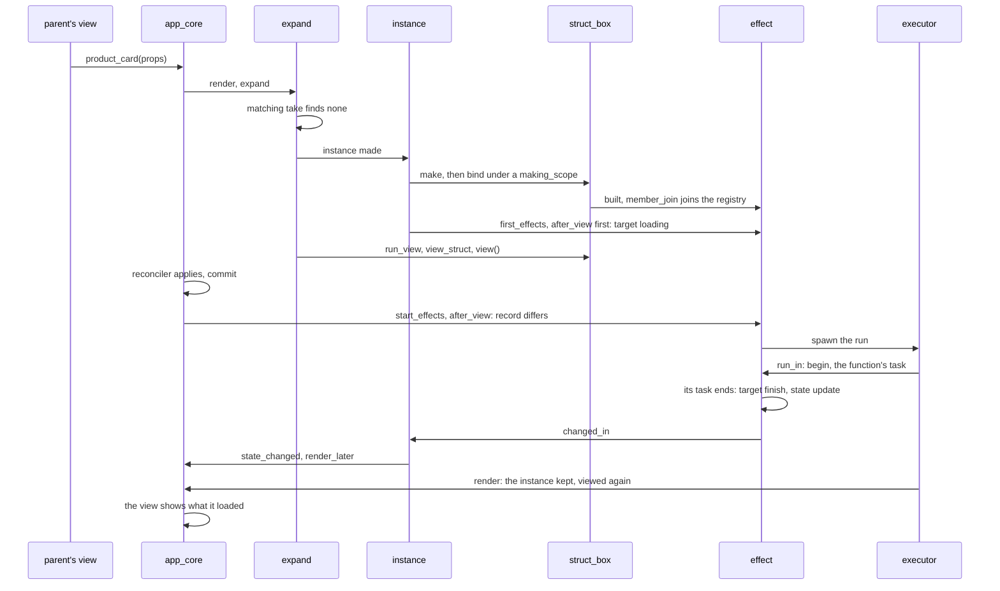
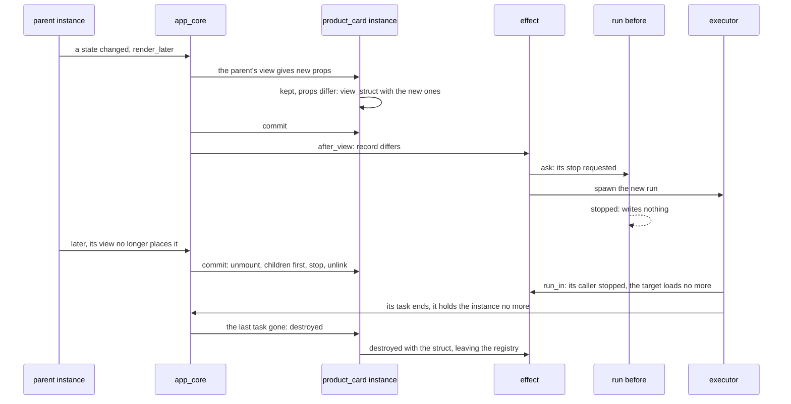

# The life of a component

How the app makes a component, views it, runs its effects and lets it go, drawn from the code of `quoll::ui`, for
whoever works on it: the diagrams name the functions that do each step. What a component is and how one is written are
in [the UI guide](ui.md); these names are Quoll's own, which a program never names, and may change with the code. Paths
are under `quoll/ui/`.

- [The states of an instance](#the-states-of-an-instance)
- [A first placement, through its first load shown](#a-first-placement-through-its-first-load-shown)
- [New props, then the removal](#new-props-then-the-removal)
- [A component written as a function](#a-component-written-as-a-function)
- [Where it runs](#where-it-runs)

## The states of an instance

- **Placed.** A call such as `product_card({.id = 3})` makes an element holding the component's table and its props
  (`hooks_element`, `include/quoll/ui/detail/component/hooks_table.hpp`, called from `component::operator()` and
  `tag<C>::operator()`). Nothing is made at the call.
- **Its place.** The app finds the instance of the last render by the component's type and its key, or its rank among
  those of its type in the parent's view without a key (`matching::take`, `src/view/expand.cpp`). Two of one type with
  one key in a view throw.
- **Making** (`instance::instance`, `src/component/instance.cpp`): its props kept, its table's `make`, its stop following
  the app's, `bind` with the contexts above it, `link` to its instance, then `first_effects`. A struct is built in
  `bind` (`struct_box::make`, `include/quoll/ui/detail/component/struct_table.hpp`) under a `making_scope`: each
  member's `member_join` joins the struct's `member_registry` as it is built, and an effect following the props finds
  where they are kept (`making_props_of`, `src/context/member_registry.cpp`). `first_effects` tells the targets whose
  first run will start that they are loading, before the first view.
- **Given again** (`walk_component`, `src/view/expand.cpp`; `instance::unchanged_view`, `src/component/instance.cpp`):
  an instance gets its last view again, and starts no effect, when none of its states changed since that view, no
  context it read changed, the code was not reloaded meanwhile, and it was placed from the same source or with props
  equal by `==` to the last ones. Props with no `==` are viewed again each time the parent's view runs.
- **Viewing** (`run_view`): a struct's props are replaced by the new ones, and restored if its view throws
  (`view_struct`); its view runs, the components of its view walked in turn. A view that throws fails the whole render:
  an instance just made goes, a kept one keeps the view it had.
- **Shown** (`app_core::render`, `src/app/app_core.cpp`): the reconciler applies the differences to the renderer, then
  the instances are committed (`viewed`), linked to the app if just made, and those left behind unmounted. A failure
  past the views discards the render (`discard`): the instances just made go, and those viewed in it drop their last
  view (`instance::tried`), so that the next render views them again.
- **Effects** (`start_effects`): after the render, those of each instance that was viewed, children before parents, then
  those of the contexts.
- **Dirty** (`instance::changed_in`): a state's change marks its instance and asks the app for a render
  (`state_changed`). Whatever the number of changes in a turn, one render is posted (`render_later`).
- **Unmounted** (`instance::unmount`): its children first, then its stop asked, then unlinked from the app. Nothing
  waits: each of its tasks holds the instance until it ends, on that stop, and the instance goes with the last
  (`~instance`), its members in reverse order, each leaving the registry.

## A first placement, through its first load shown

A component written as a struct whose `resource` follows `&props::id`:

- **The first run** starts after the first render is shown, as React runs an effect once its render is committed. Its
  target said it was loading before that view, so the first frame shows it loading (`effect::after_view`,
  `src/data/effect.cpp`).
- **What a run reads** of the props is read at that view, by its field or its function, and copied into the run
  (`effect::props_reader`, `include/quoll/ui/data/effect.hpp`): the run holds no reference into props that the next
  view replaces.
- **Its end** writes its target at once, which tells the instance, which asks for a render (`run_in`,
  `include/quoll/ui/detail/data/run_slot.hpp`; `write_quietly`, `include/quoll/ui/detail/data/target.hpp`).

## New props, then the removal

- **A change** of what an effect follows stops the run before at once (`ask`, `src/data/run_slot.cpp`): a run whose answer
  comes after writes nothing, even one that ignored the stop.
- **What it follows holding none**, as an optional, stops the run before; a `resource` then holds nothing loaded
  (`target_hooks::release`).
- **The removal** asks its stop: a run ended by it only sets its target's flag back, which nothing shows, as the
  instance is unlinked. A run's frame is destroyed once it will not resume, by its root (`docs/CODING_RULES.md`); the
  instance outlives its tasks, each holding it until it ends.

## A component written as a function

The same steps, with these differences:

- **Its hooks** live in a `hook_store`, empty when the instance is made, filled by its first view: each `use_` call is
  found again by where it is called, its file, line and column, and its rank among the calls from there
  (`hook_store::find`, `include/quoll/ui/detail/component/hook_store.hpp`; `next_call` and `find_made`,
  `src/component/hook_store.cpp`). A call that finds a hook of another type there throws (`find_made`).
- **An effect made in the first view** tells its target that it is loading during that view (`use_effect_at`,
  `include/quoll/ui/component/hooks.hpp`), before the instance is linked: the first frame shown does not hold the flag,
  unless the view read the target after that call, and the render posted at the end of that one shows it loading.
- **A run calls the function of the view that asked for it**, once that view is shown, with the props it was given
  (`effect_hook`, `include/quoll/ui/component/hooks.hpp`).

## Where it runs

- **One executor**: the app's views, its effects, its handlers and its actions run on the executor it was given, one
  thing at a time (`include/quoll/ui/detail/app/app_core.hpp`). Natively, an executor of a runtime of several threads is
  a strand.
- **A render** is posted once for all the changes of a turn. It walks every instance from the root, viewing those whose
  props, states or contexts changed and giving the others their last view again.
- **A failure**: a view that throws in a render the app posted fails that render, which shows nothing new, and the app's
  `on_error` hears of it; in `app::start()`, the app stops and `start()` throws it to its caller. A run that fails
  writes its target's error, and the app's `on_error` hears of it.
